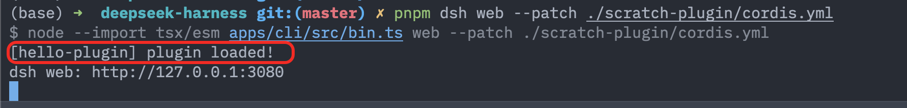

# 从实践理解 DeepSeek Harness：一切皆插件、每一次运行都有迹可循、多种运行模式

> 研究与实验日期：2026-08-18（Asia/Shanghai）
>
> 源码基线：本仓库提交 `5a3f3dd5fd`。DeepSeek Harness 仍处于 Developer Preview，接口与社区生态都可能快速变化。

## 课程目标

学完本课程，你应该获得两种能力。

第一，能用自己的话解释并亲手体验 DeepSeek Harness 官方强调的三大特性：**一切皆插件（Everything is a plugin）**、**每一次运行都有迹可循（Every run is traceable）**、**多种运行模式（Multiple runtime modes）**。

第二，不再把 Cordis、Preset、Plugin、Effect、Fiber、Service、Event、Profile、Bundle、Patch 当作散乱术语，而是能把它们放回同一条执行链：Profile 选择组合，Bundle 和 Patch 改写组合，Plugin 挂载能力，Fiber 表示一次插件实例，Service 和 Event 连接插件，Effect 保证卸载时撤销贡献，Preset 再从这棵插件树中选择一套 Agent 能力。

---

## 第一章 官方如何介绍 DeepSeek Harness

### 1.1 官方原始资料

本章只用 DeepSeek 官方渠道、官方仓库，以及官方仓库直接引用的 Cordis 一手材料定义产品；社区资料只放到第四章。

| 资料 | 身份 | 本课程用它回答什么 | 入口 |
| --- | --- | --- | --- |
| DeepSeek Harness 产品页 | DeepSeek 官网 | 产品定位、三大特性、四种运行模式、官方演示 | [中文](https://www.deepseek.com/harness/) · [English](https://www.deepseek.com/harness/en/) |
| DeepSeek Harness 源码 | `deepseek-ai` 官方仓库，MIT | 实际实现、启动方法、配置和插件边界 | [GitHub](https://github.com/deepseek-ai/deepseek-harness) · [本地 README](../../README.zh.md) |
| DeepSeek Harness 文档 | 与官方仓库同步维护 | 用户指南、Develop 教程、架构和 API | [在线文档](https://deepseek-harness.github.io/deepseek-harness/) · [本地用户指南](../../docs/user/guide/index.zh.md) |
| *A Programming Paradigm for Spatiotemporal Composability* | 北京大学与 DeepSeek-AI 作者联署的 Cordis 论文 | 为什么插件可以动态加载、卸载、替换与重组 | [论文仓库](https://github.com/cordiverse/paper) · [PDF](https://github.com/cordiverse/paper/blob/948a07b369c62adb3b12e102458be5c18dfb69b9/paper.pdf) |
| Cordis | 官方 README 直接引用的底层框架 | Context、Fiber、Effect、Service、Event 的运行时实现 | [GitHub](https://github.com/cordiverse/cordis) · [官方教程](https://deepseek-harness.github.io/deepseek-harness/develop/cordis-tutorial/) |
| 官方发布与社区入口 | DeepSeek / DeepSeek Harness | 版本动态、讨论和插件发现约定 | [发布帖](https://x.com/deepseek_ai/status/2087887408440164663) · [Discussions](https://github.com/deepseek-ai/deepseek-harness/discussions) · [Discord](https://discord.gg/Ycq5dCaS4) |

产品页内嵌了一段“实时定制页面元素、工具和 Agent Preset”的官方演示，但没有公开独立 MP4、YouTube 或 Bilibili 地址，所以本课程只链接[演示所在的官方页面](https://www.deepseek.com/harness/en/#products)，不伪造一个视频直链。

论文要解决的不是“怎么写一个 coding agent”，而是更底层的问题：一个长期运行的系统，怎样在**时间上**安全撤销组件造成的变化，又怎样在**空间上**根据依赖的出现、消失与替换重新组合组件。Cordis 把这两个问题分别落成可逆 Effect 与响应式依赖，DeepSeek Harness 再把它们用在模型、工具、会话、沙箱、存储、Agent Loop、调度和 UI 上。

### 1.2 Agent = Model + Harness

官方产品页把关系写成一句很短的公式：

> **Agent = Model + Harness**

模型负责推理与生成；Harness 负责把环境、工具、上下文、权限、持久化和执行循环组织起来。换句话说，同一个模型放进不同 Harness，能看到的上下文、可调用的工具、失败恢复方式和最终任务成功率都可能不同；评价 Agent 时不能把成绩全算到模型头上。

DeepSeek Harness 的特别之处，是没有把 Harness 再做成一个不可拆的“大内核”。官方 README 只给 Cordis 内核留下插件加载、卸载与依赖管理，Agent 能力则来自插件组合。配置大致经历下面这条链：

```text
Profile
  └─ 选择 Bundle
       └─ Bundle 提供 cordis.patch.yml
            └─ Patch 插入、删除或改写插件项
                 └─ Cordis Loader 挂载 Plugin
                      └─ 每个实例成为 Fiber
```

这里最容易混淆的几个词可以先这样记：

| 名词 | 先记住的含义 |
| --- | --- |
| Cordis | 管理插件树、依赖与生命周期的运行时，不是一个 Agent 模型 |
| Plugin | 向共享 Context 贡献一项能力的模块 |
| Fiber | 某个 Plugin 的一次运行时实例与生命周期句柄 |
| Effect | 插件加载时产生、卸载时必须被撤销的贡献或资源 |
| Service | 一个插件提供、其他插件通过名字注入并直接调用的能力 |
| Event | 发布方不需要知道监听者是谁的通知或协作协议 |
| Bundle | 可安装的插件组合包；它通过 `dsh.bundle.patch` 指向一份 patch，一次插入或配置多个 Plugin |
| Profile | 一次启动选择的依赖集合与 Bundle 集合，例如 `web` |
| Preset | 一个会话所选的 Agent 能力组合；它可以过滤工具、改 persona、换 loop 或增加子 Agent |

### 1.3 DeepSeek Harness 的三大核心特性

这一节保留官方产品页的原始标题，再结合官方图片与源码链接界定它到底承诺了什么。

**Everything is a plugin.** 官方列出的范围不只是模型工具，还包括 skills、session、sandbox、storage、agent loop、scheduling 和 UI。源码 README 也直接写明该架构由 Cordis 驱动。这里的“everything”是架构边界：这些能力都通过组合项进入运行时；它不表示任意第三方代码都天然安全，也不表示所有外部副作用都能无损回滚。


**Every run is traceable.** 官方把系统提示词、reasoning、工具调用与结果、上下文注入和子 Agent 调度放进 append-only Session Log，并由同一事实流支持 Trajectory、resume、fork、search 与 replay。模型上下文不是简单“把 `.log` 文件全文塞给模型”，而是从 Session 事件投影、过滤和编码得到；对应实操将在 3.2.1 完成。


**Multiple runtime modes.** 官方提供的不是四个模型，而是四套 Harness 组合：

| 官方模式 | Harness 侧差异 | 适合感受什么 |
| --- | --- | --- |
| Standard | 文件、Shell、搜索、Skills、计划、目标、子 Agent 与工作流等完整能力 | 日常 coding agent |
| PTC / Code Mode | 保留完整能力，但让模型通过 TypeScript 程序组合多步工具 | 工具调用协议本身也可替换 |
| Minimal | 只保留持久 Bash 与 `str_replace_editor` | 在极简 Harness 中观察模型本体 |
| Creator | 在 Standard 上增加运行时检查、插件实验与 Preset 创作入口 | 创建自己的 Runtime |

因此，三大特性不是三条孤立广告语。插件化让不同能力可以组合；事件日志让组合运行之后仍可检查；Preset 与运行模式则把不同组合变成用户可选择的 Agent。

---

## 第三章 官方三大特性体验及原理

### 3.1 一切皆插件


#### 3.1.1 官方插件体验

DeepSeek Harness 基于 [Cordis](https://github.com/cordiverse/cordis) 插件系统构建。模型、工具、技能、会话、沙箱、存储、循环、调度、UI 等所有 Agent 能力均由插件提供，并通过 Cordis 服务与事件彼此协作。开发者无需改动 DeepSeek Harness 源码，即可在配置层选择、替换或扩展任一能力。


- 源码怎么定义插件


下面安排四个独立实验，分别验证本地插件、模型工具和 Provider 配置热更新；第四个实验从可构建源码到其他用户按包名安装的发布链路。

四个实验使用三种启动方式，对应插件从开发到交付的不同阶段：
| 阶段 | 对应章节 | 配置怎样进入运行时 | 为什么采用这种方式 |
| --- | --- | --- | --- |
| 在 Web 中调试本地源码 | 3.1.2、3.1.3 | `pnpm dsh web --patch <文件>` 在本次启动中临时叠加一份 patch | 不安装插件，不修改 Profile，停止进程后这份临时叠加就结束 |
| 在完整 Web 中验证配置热更新 | 3.1.4 | 把实验配置加入 Web Profile 自己的 `cordis.patch.yml` | Web 持续监听这份 Profile patch；保存后重新组合变化的插件，页面和其他插件继续运行 |
| 安装并交付插件 | 3.1.5 | `dsh plugin add` 读取 npm 包内的 Bundle Patch，并把 Bundle 加入 Web Profile | 安装完成后，正常执行 `pnpm dsh web` 就会加载插件，不必每次手写 `--patch` |

四个实验也可以在第三章交互式 Workshop 中逐步执行。它保留真实执行按钮和流式终端，切换实验不会停止其他步骤中正在运行的 Web：

```sh
node parker/tutorial-labs/workshop/workshop-server.mjs
```

启动后打开 `http://127.0.0.1:3090`。


#### 3.1.2 动手开发 1 个 Hello 日志打印插件

本实验依据官方教程[《第一个插件》](https://deepseek-harness.github.io/deepseek-harness/develop/basic/)。目标是在不修改 Harness 源码的情况下，通过一次性 patch 加载本地 TypeScript 插件，并从终端确认 Cordis 已经调用它的 `apply(ctx)`。

**第一步：创建本地项目。** 从已经能够通过源码运行 DeepSeek Harness 的仓库检出开始，在仓库根目录执行：

```sh
mkdir -p parker/tutorial-labs/plugin-workshop/00-first-plugin/src
```

**第二步：写出最小插件。** 创建 `parker/tutorial-labs/plugin-workshop/00-first-plugin/src/my-plugin.ts`：

```ts
import type { Context } from '@deepseek-ai/cordis'

export const name = 'hello-plugin'

export function apply(ctx: Context) {
  // Required dependencies are ready before apply runs.
  console.log('[hello-plugin] plugin loaded!')
}
```

此时插件只有一个可观察结果：Cordis 加载模块后调用 `apply(ctx)`，终端打印一行日志。

**第三步：把插件插入 Web 配置。** 在仓库根目录运行 `pwd`，复制输出的绝对路径。创建 `parker/tutorial-labs/plugin-workshop/00-first-plugin/cordis.yml`，并把示例路径替换为刚才得到的路径：

```yaml
- insert:
    - id: hello
      name: '/absolute/path/to/deepseek-harness/parker/tutorial-labs/plugin-workshop/00-first-plugin/src/my-plugin.ts'
```

这里必须使用绝对路径。patch 文件贡献的是一段配置；Loader 解析模块路径时仍以 Profile 目录为基准，因此相对路径不会以实验目录中的 `cordis.yml` 为基准。

**第四步：启动并验收最小插件。** 使用刚创建的覆盖层启动 Web：

```sh
pnpm dsh web --patch ./parker/tutorial-labs/plugin-workshop/00-first-plugin/cordis.yml
```

打开 `http://127.0.0.1:3080`。启动期间，终端应出现：

```text
[hello-plugin] plugin loaded!
```



实际运行结果与官方教程一致：启动命令进入源码启动器后，终端先打印 `[hello-plugin] plugin loaded!`，随后给出 Web 地址 `http://127.0.0.1:3080`。这说明 Loader 已经解析 patch 中的绝对模块路径、导入 `my-plugin.ts` 并调用 `apply(ctx)`，从 TypeScript 模块、Cordis 配置到运行中插件的最小闭环已经成立。

完成截图后停止当前 Web 进程。后续实验使用自己的源码和 patch，不再加载 `00-first-plugin/cordis.yml`。

#### 3.1.3 动手开发 1 个 Greet Tool 插件

本实验依据官方教程[《开发一个工具》](https://deepseek-harness.github.io/deepseek-harness/develop/basic/tool)。它不会修改 3.1.2 的文件，而是创建一个独立插件；启动时只加载本实验的自定义 patch。

**第一步：创建独立项目。** 在仓库根目录执行：

```sh
mkdir -p parker/tutorial-labs/plugin-workshop/01-simple-greet-tool/src
```

**第二步：创建工具插件。** 将下面的实现保存为 `parker/tutorial-labs/plugin-workshop/01-simple-greet-tool/src/greet-tool.ts`：

```ts
import type { Context } from '@deepseek-ai/cordis'
import { defineTool } from '@deepseek-ai/dsh-tools'

export const name = 'greet-tool'
export const inject = ['tools']

export function apply(ctx: Context) {
  ctx.tools.register(defineTool({
    name: 'greet',
    description: 'Greet someone by name.',
    parameters: {
      name: { type: 'string', required: true, description: 'The name to greet' },
    },
    output: {
      schema: { type: 'string' },
      render: (_args, value) => [{ type: 'text', text: value }],
    },
    async execute(args) {
      return `Hello, ${args.name}!`
    },
  }))
}
```

**第三步：创建独立 patch。** 将仓库绝对路径写入 `parker/tutorial-labs/plugin-workshop/01-simple-greet-tool/cordis.yml`：

```yaml
- insert:
    - id: greet-tool
      name: '/absolute/path/to/deepseek-harness/parker/tutorial-labs/plugin-workshop/01-simple-greet-tool/src/greet-tool.ts'
```

**第四步：启动并调用工具。** 使用本实验自己的 patch 启动：

```sh
pnpm dsh web --patch ./parker/tutorial-labs/plugin-workshop/01-simple-greet-tool/cordis.yml
```

打开 `http://127.0.0.1:3080`，输入：

```text
Use the greet tool to greet Ada.
```

模型可以调用 `greet`，工具执行后返回 `Hello, Ada!`。本实验结束后停止当前进程；3.1.2 的 `hello-plugin` 不会出现在这次启动中。

#### 3.1.4 在 Web 中热更新 1 个模拟 Provider

本实验依据官方[《插件配置》](https://deepseek-harness.github.io/deepseek-harness/develop/basic/config)、[《组合与 HMR》](https://deepseek-harness.github.io/deepseek-harness/develop/cordis-tutorial/06-composition-and-hmr)和[CLI Profile 启动参考](https://github.com/deepseek-ai/DeepSeek-Harness/blob/master/apps/cli/reference/README.zh.md)，目标是在完整的 DeepSeek Harness Web 中修改模拟 Provider 的 `apiKey` 与 `baseURL`，从 Web 进程日志观察旧 Provider 和 Consumer 卸载后按新配置恢复。浏览器页面、模型配置和默认 Web 插件在整个实验中保持运行。

3.1.2、3.1.3 传给 `--patch` 的是一次性启动覆盖层：Web 只在启动时读取，保存该文件不会触发热更新。
本节改用 Web Profile 自己的 `cordis.patch.yml`；长时间运行的 Web 会持续监听这份用户配置并重新组合变化的插件。因此本实验正常启动 Web，不再传 `--patch`。

**先认识 Web Profile。** Profile 是一套可启动的插件组合；`pnpm dsh web` 是 `pnpm dsh --profile web` 的别名，两条命令都会加载名为 `web` 的 Profile。这里的插件组合包（Bundle）不是某一个运行中的 Plugin，而是一个可安装的 npm 包：它在 `package.json` 中用 `dsh.bundle.patch` 指向随包提供的 `cordis.patch.yml`，这份 patch 可以一次插入、配置或禁用多个 Plugin。Profile 按顺序列出若干 Bundle，再叠加用户 patch，最终得到本次启动的插件树。

三者的关系可以直接记为：Plugin 是一项运行时能力，Bundle 负责打包一组插件配置，Profile 负责选择若干 Bundle 并启动组合出的插件树。本课程使用的 Web Profile 位于 `~/.dsh/profiles/web`，其中包含四个文件：

```text
~/.dsh/profiles/web/
├── package.json
├── cordis.yml
├── cordis.patch.yml
└── pnpm-workspace.yaml
```

| 文件 | 当前职责 | 本实验是否修改 |
| --- | --- | --- |
| `package.json` | Profile 清单；`dsh.profile.bundles` 选择组成 Web 的插件组合包 | 否 |
| `cordis.yml` | Loader 所需的空根配置，由启动器维护和重写 | 否 |
| `cordis.patch.yml` | 用户可编辑的 Profile patch，覆盖 Bundle 配置或插入额外插件 | 是 |
| `pnpm-workspace.yaml` | Profile 安装外部 npm 插件时使用的 pnpm 工作区配置 | 否 |


修改 `cordis.patch.yml` 能触发热更新。相比之下，`--patch <文件>` 是本次进程额外叠加的启动覆盖层，启动器不会为这个任意文件注册实时监听，所以 3.1.2、3.1.3 保存各自的 `cordis.yml` 不会触发上述流程。

**第一步：打开 Web Profile 的用户 patch。** 用编辑器打开 `~/.dsh/profiles/web/cordis.patch.yml`

**第二步：把实验配置加入 Profile patch。**
```yaml
- insert:
    - id: tutorial-mock-provider
      name: '/absolute/path/to/deepseek-harness/parker/tutorial-labs/plugin-workshop/03-provider-config-hmr/mock-provider.ts'
      config:
        apiKey: 'demo-key-BEFORE-HMR-OLD1'
        baseURL: 'https://provider-before-hot-reload.invalid/api/v1/legacy-region'
    - id: tutorial-provider-consumer
      name: '/absolute/path/to/deepseek-harness/parker/tutorial-labs/plugin-workshop/03-provider-config-hmr/provider-consumer.ts'
```


```sh
pnpm dsh --profile web --dump-config
```

**第三步：启动完整 Web。** 正常启动
```sh
pnpm dsh web
```

启动后终端会同时给出插件日志和 Web 地址：
```text
[mock-provider] loaded baseURL=https://provider-before-hot-reload.invalid/api/v1/legacy-region apiKey=demo...OLD1
[provider-consumer] using https://provider-before-hot-reload.invalid/api/v1/legacy-region
dsh web: http://127.0.0.1:3080
```

打开终端给出的地址，确认完整 Web 页面可以正常访问。Provider 注册 `mockProvider` Service，Consumer 通过 `inject = ['mockProvider']` 等待并使用它；本实验不需要向模型发送消息。

**第四步：保持 Web 运行并修改参数。** 回到第一步已经打开的 `cordis.patch.yml`，把同一配置项改为第二组假参数并保存：

```yaml
config:
  apiKey: 'demo-key-AFTER-HMR-NEW2'
  baseURL: 'https://provider-after-hot-reload.invalid/api/v2/new-region'
```

这次修改同时改变域名前缀（`before-hmr` → `after-hmr`）、接口版本（`v1` → `v2`）和 API Key 脱敏后仍可见的尾部（`OLD1` → `NEW2`）。HMR 根据稳定 `id` 重配该项，实际输出如下：

```text
[mock-provider] disposed baseURL=https://provider-before-hot-reload.invalid/api/v1/legacy-region
[provider-consumer] detached
[mock-provider] loaded baseURL=https://provider-after-hot-reload.invalid/api/v2/new-region apiKey=demo...NEW2
[provider-consumer] using https://provider-after-hot-reload.invalid/api/v2/new-region
```

不重启 Web，再次访问原地址仍能得到页面。Provider 消失期间，声明硬依赖的 Consumer 自动卸载；新服务出现后 Consumer 自动恢复。API Key 只使用假值并脱敏打印。真实 Provider 不应把密钥写入日志，生产插件通常保存凭据引用，并在请求时解析凭据。

**第五步：清理实验配置。** 从 `~/.dsh/profiles/web/cordis.patch.yml` 中删除刚才加入的整个 `insert` 条目并保存；如果文件中没有其他条目，恢复为 `[]`。同一个 Web 进程会打印：

```text
[mock-provider] disposed baseURL=https://provider-after-hot-reload.invalid/api/v2/new-region
[provider-consumer] detached
```

Web 页面继续运行，但本节的两个插件已经移除。至此，本实验既验证了完整 Web 中的 Provider 配置热更新，也恢复了开始实验前的插件组合。


#### 3.1.5 打包并发布 1 个蚂蚁 UI 插件

本实验依据官方[《打包与安装插件》](https://deepseek-harness.github.io/deepseek-harness/develop/basic/publish)，使用已经完成的 `dsh-running-ant`，不展开 React 组件、动画和 Slot 接入的开发过程。插件在当前会话生成期间显示一只往返爬行的蓝色蚂蚁，生成结束后自动隐藏；它不修改系统提示词，不注册模型工具，不发送网络请求，也不写入 Session Log。

本节进入插件交付阶段：3.1.2、3.1.3 直接从绝对路径加载 TypeScript 源码，适合本机调试；要让别人安装，插件必须成为一个自包含的 npm 包。插件工作区位于 `parker/ds_plugin/`，参与发布的源码包在 `parker/ds_plugin/plugins/dsh-running-ant/`，打包结果输出到 `parker/ds_plugin/dist/`。

这里的 **npm 安装包** 是一个以 `.tgz` 结尾的压缩文件，npm 和 pnpm 文档也称它为 tarball。它不是另一份源码目录，而是 `pnpm pack` 按 `package.json` 的发布规则收集出的成品，里面应当只有使用者安装插件所需的 JavaScript、类型声明、Bundle Patch、说明和许可证。发布到 npm Registry 的也是同一组文件。

打包前首先检查 `package.json` 的四组关键声明：

```json
{
  "name": "dsh-running-ant",
  "version": "0.1.0",
  "main": "lib/index.js",
  "files": [
    "lib/**/*.js",
    "lib/**/*.js.map",
    "lib/**/*.d.ts",
    "lib/**/*.d.ts.map",
    "cordis.patch.yml",
    "README.md",
    "LICENSE"
  ],
  "scripts": {
    "prepack": "pnpm build"
  },
  "dsh": {
    "bundle": { "patch": "./cordis.patch.yml" },
    "client": {
      "inject": [
        "@deepseek-ai/dsh-client-runtime",
        "@deepseek-ai/dsh-client-ui-conversation"
      ],
      "platform": "web"
    }
  }
}
```

`prepack` 保证打包和发布前生成 `lib/`；`files` 是进入 npm 包的白名单；`dsh.bundle.patch` 让 `dsh plugin add` 把插件加入目标 Profile；`dsh.client` 告诉 Web ModuleLoader 加载浏览器端产物。随包发布的 `cordis.patch.yml` 使用 npm 包名，而不是开发机上的源码路径：

```yaml
- insert:
    - id: ui-running-ant
      name: dsh-running-ant
```

**第一步：测试并生成 `.tgz` 安装包。** 在仓库根目录执行：

```sh
cd parker/ds_plugin
pnpm install
pnpm --filter dsh-running-ant typecheck
pnpm --filter dsh-running-ant test
pnpm pack:running-ant
```

最后一条命令会先执行 `prepack` 构建插件，再生成 npm 安装包 `parker/ds_plugin/dist/dsh-running-ant-0.1.0.tgz`。发布前检查这个 `.tgz` 成品，而不是只检查源码目录：

```sh
tar -tzf dist/dsh-running-ant-0.1.0.tgz
```

输出至少应包含 `package.json`、`cordis.patch.yml`、`lib/index.js`、`lib/client.js`、`README.md` 和 `LICENSE`。Host 空入口、浏览器插件、Bundle Patch 三者缺少任意一个，安装后都不能形成完整的 Web 插件。

**第二步：用 `.tgz` 安装包完成发布前验收。** 回到 Harness 仓库根目录，把这个本地安装包加入 Web Profile：

```sh
cd ../..
pnpm dsh plugin --profile web add \
  file:/absolute/path/to/deepseek-harness/parker/ds_plugin/dist/dsh-running-ant-0.1.0.tgz
pnpm dsh --profile web --dump-config
```

最终配置中应出现：

```yaml
# == dsh-running-ant
- id: ui-running-ant
  name: dsh-running-ant
```

这一步没有使用 `--patch`，因为 `plugin add` 已经完成了两件事：安装 `.tgz` 中的 npm 包，并根据包内 `dsh.bundle.patch` 把 `dsh-running-ant` 加入 Web Profile。此后每次正常启动该 Profile 都会组合这个 Bundle；只有尚未安装的本地源码实验才需要通过 `--patch` 临时加入。

再执行 `pnpm dsh web`，新建会话并发送一个需要等待几秒的任务。验收标准是生成期间蓝色蚂蚁出现在输入框上方，生成停止后自动消失。这个步骤验证的是 `.tgz` 中的发布产物，而不是仍能访问开发源码的工作区。

**第三步：发布到 npm。** 当前 `dsh-running-ant@0.1.0` 尚未发布到 npm Registry。确认包名、版本和发布账号后，在插件源码目录先做不会上传的发布预演：

```sh
cd parker/ds_plugin/plugins/dsh-running-ant
npm login
npm whoami
git status --short
pnpm publish --dry-run --access public
```

发布应从干净的 Git 工作树进行；`git status --short` 有输出时，先检查并提交本次发布需要的源码、manifest 与 lockfile 变化。预演列出的文件应与前面的 `.tgz` 安装包检查一致。每个 npm 版本只能发布一次；如果 `0.1.0` 已经存在，先修改 `package.json` 中的版本并同步 lockfile。确认无误后执行真正的发布命令：

```sh
pnpm publish --access public
```

这一步会把包公开上传到 npm，只有包所有者可以执行。不要在教程复现阶段直接运行；应先完成 `.tgz` 安装包验收，再由发布者明确确认版本后操作。

**第四步：让其他用户按包名安装。** npm 发布成功后，其他用户不需要插件源码、TypeScript 编译器或本地 `.tgz` 文件，直接在自己的 Harness 环境中执行：

```sh
pnpm dsh plugin --profile web add dsh-running-ant@0.1.0
pnpm dsh --profile web --dump-config
pnpm dsh web
```

升级时先发布一个新版本，再用 `plugin add dsh-running-ant@<新版本>` 更新；卸载使用：

```sh
pnpm dsh plugin --profile web remove dsh-running-ant
```

这一实验完成了源码插件与社区插件之间的转换：作者发布的是带 `dsh.bundle` 和预构建 Client 产物的 npm 包，使用者安装的是包名，Profile 根据包内 patch 激活 UI 插件。

#### 3.1.6 从真实开发案例看插件的原理

上面的四个独立实验分别验证插件加载、工具注册、Provider 配置热更新，以及 UI 插件的打包、发布和安装。原理说明来自官方[《第一个插件》](https://deepseek-harness.github.io/deepseek-harness/develop/basic/)、[《开发一个工具》](https://deepseek-harness.github.io/deepseek-harness/develop/basic/tool)、[《插件与生命周期》](https://deepseek-harness.github.io/deepseek-harness/develop/framework/)、[《组合与 HMR》](https://deepseek-harness.github.io/deepseek-harness/develop/cordis-tutorial/06-composition-and-hmr)和[《打包与安装插件》](https://deepseek-harness.github.io/deepseek-harness/develop/basic/publish)。

| 开发步骤 | 实验结果 | 对应原理 |
| --- | --- | --- |
| 导出 `apply(ctx)` | 启动时打印加载日志 | 插件首先是一个由 Cordis 加载的 TypeScript 模块；框架在加载时调用 `apply` 并传入 Context |
| 用 `--patch` 插入绝对路径 | 不修改 Harness 源码也能加载本地模块 | patch 贡献配置；模块路径仍由 Loader 按 Profile 目录解析 |
| 声明 `inject = ['tools']` | `apply` 运行时可以使用 `ctx.tools` | `inject` 是依赖声明，Cordis 等待依赖服务就绪后再加载插件 |
| 调用 `ctx.tools.register(...)` | Agent 的工具集合中出现 `greet` | 插件通过 Context 注册能力，注册结果归属于该插件的生命周期 |
| 定义 `parameters` 与 `execute` | 模型提供姓名，工具返回规范字符串 | `defineTool` 根据参数定义推导并校验 `args`，`execute` 只负责产生结果值 |
| 定义 `output.schema` 与 `output.render` | `Hello, Ada!` 转换为模型可见文本 | schema 规定工具的规范结果，render 将结果转换为面向模型的内容块 |
| 保存 Web Profile 的 `cordis.patch.yml` | Web 不重启，旧实例清理后按新参数加载 | 稳定 `id` 标识配置项，Effect 让旧贡献可以完整撤销 |
| 打包 `dsh-running-ant` | `.tgz` 安装包同时包含 Host、Client 和 patch | `files` 控制发布内容，`dsh.bundle.patch` 声明安装后应用的配置层 |
| 安装本地 `.tgz` 文件 | Web Profile 出现 `ui-running-ant` | `dsh plugin add` 安装依赖，并把组合包加入 Profile 的 Bundle 层列表 |


四个实验展示了“一切皆插件”的完整入门路径：本地 patch 验证最小插件，工具插件进入模型调用链，Service 与 HMR 支持 Provider 重配，Bundle 与 npm 再把 UI 插件交付给其他用户安装。

### 3.2 每一次运行都有迹可循

模型看到的一切都会写入仅追加设计的会话日志，包括系统提示词、思维链、工具调用与结果、子 Agent 调度，以及每一次上下文注入。在 Trajectory 视图中，你可以按来源查看这些信息。恢复、分叉、检索与回放也共享同一份事件流。

#### 3.2.1 运行轨迹体验

> 待下一阶段：直接选取当前已有会话，从 Session Log 到 Chat/Trajectory 投影逐条核对，不再额外制造对话。

#### 3.2.2 从真实运行案例看轨迹的原理

> 待 3.2.1 实验完成后对应展开：append-only Session、事件投影、模型上下文、Trajectory、恢复与 fork。

### 3.3 多种运行模式

标准模式提供完整的工具组合；PTC 模式通过模型生成的一段代码组合多轮工具调用；极简模式仅保留一个 shell 工具与一个文件编辑工具，用于最小化环境下的模型基准测试；创造模式可以检查当前运行时、在内存中试验 Cordis 插件，并据此组合和创作新的模式。

#### 3.3.1 多种运行模式体验

> 待下一阶段：比较 Standard、PTC、Minimal 与自定义 Preset，并完成“Codex + Claude Code 交叉 PR 评审”。

#### 3.3.2 从真实模式对比看运行模式的原理

> 待 3.3.1 实验完成后对应展开：Preset、Context 隔离、工具过滤、Agent Loop 与 Subagent Provider。

---

## 第四章 社区与未来

### 4.1 社区插件的发现、安装与体验

官方目前没有类似 VS Code Marketplace 的审核式商店。官方 README 给出的发现约定，是给仓库添加 [`dsh-plugin`](https://github.com/topics/dsh-plugin) Topic；社区又建立了 [Awesome DSH Plugin](https://github.com/awesome-dsh-plugin/awesome-dsh-plugin) 与 `dsh-find-plugin`。GitHub Topic 只是标签，不是兼容性或安全认证，而且实际搜索已经混入大量与 DSH 无关或只顺手打标签的高 Star 仓库，所以不能把 Topic 的 Star 排行直接当“插件排行榜”。

本机已经实际安装并由最终 Cordis 配置确认的社区插件有两组：

| 包与版本 | 已验证的作用 | 安装命令 | 许可证 |
| --- | --- | --- | --- |
| [`dsh-find-plugin@0.3.6`](https://github.com/awesome-dsh-plugin/dsh-find-plugin) | 注册 `find_dsh_plugin` 工具，实时搜索 GitHub `dsh-plugin` Topic，并用 Awesome 清单的双语描述补充结果 | `pnpm dsh plugin --profile web add dsh-find-plugin` | MIT |
| [`@linxin666/dsh-web-ui-all@0.1.17`](https://github.com/zhu1090093659/dsh-web-ui) | 聚合任务看板、Git 图、宠物、远程 Web、实时统计、SSH、图片描述、皮肤等 Web 插件 | `pnpm dsh plugin --profile web add @linxin666/dsh-web-ui-all` | Apache-2.0 |

`dsh-web-ui-all` 是聚合包，不是单一按钮。当前本机 `--dump-config` 已看到 `ui-task-board`、`ui-git-graph`、`pet`、`live-stats`、`ssh`、`describe-image`、`ui-skin-center` 等组合项；它的优点是一条命令获得完整 Web 体验，代价是所有子插件一起激活，并且它固定依赖特定 `@deepseek-ai/*` SDK 版本，升级 DSH 时要重新检查兼容性。

安装、验证与卸载应当是一组动作，而不是只运行第一条命令：

```sh
cd /Users/parker/Documents/git/agents/deepseek-harness

# 安装
pnpm dsh plugin --profile web add dsh-find-plugin
pnpm dsh plugin --profile web add @linxin666/dsh-web-ui-all

# 查看最终组合，而不是只看 package.json
pnpm dsh --profile web --dump-config

# 完全重启 Web，前端插件才会重新装载
pnpm dsh web

# 不再需要时卸载
pnpm dsh plugin --profile web remove dsh-find-plugin
pnpm dsh plugin --profile web remove @linxin666/dsh-web-ui-all
```

日常发现可以直接对安装了 `dsh-find-plugin` 的 Agent 说：“找一个能查看 Git diff 的插件”或“找一个任务完成后通知我的插件”。但安装前至少审查五项：仓库是否真的含 `dsh.bundle.patch` 或 Client 声明；安装脚本会做什么；插件注入哪些 Service、监听哪些 Event、注册哪些工具；是否读写文件、网络或凭据；是否锁定版本或 commit。第三方插件与 Agent 处于同一进程时，获得的不是“主题皮肤权限”，而是它代码实际能访问的宿主权限。

本课程自己的 `dsh-running-ant` 提供了一个适合作为审查基线的小插件：功能单一、无网络、无持久化、插槽明确、4 个测试、可打包、可卸载。后续挑社区插件时，可以拿它对照“一个插件最少应说明哪些事情”。

### 4.2 DeepSeek Harness 对 Agent 发展的影响

DeepSeek Harness 最值得关注的不是“又多了一个 coding agent”，而是它把 Agent 产品从一个固定程序推向一个可组合运行时。模型、工具和 UI 只是第一层；当 Session、权限、Loop、调度和子 Agent Provider 也能成为插件时，团队可以复用同一宿主，为不同任务装配不同 Agent，而不是维护多个相互分叉的客户端。

第一种影响是 **Harness 成为可比较变量**。`Agent = Model + Harness` 意味着同模型评测必须记录工具集合、Preset、预算、上下文策略与并行方式。Minimal 与 Standard 的并存尤其有价值：前者更接近测模型，后者测完整系统；如果不写清模式，benchmark 分数就不可解释。

第二种影响是 **能力市场可能从工具市场升级为 Runtime 市场**。传统插件多增加一个命令或面板；DSH 插件还可以替换模型路由、持久化、沙箱、Agent Loop 与调度。这让“安装一种工作方式”成为可能，但也显著放大供应链风险：一个看似 UI 的 Bundle 可能同时带入 Host 工具、网络访问和后台任务。

第三种影响是 **动态重组让长期运行 Agent 更现实**。Fiber、Effect 与响应式依赖使插件能在不重启整个进程的情况下退出、替换和恢复；Session Log 又把运行事实从瞬时内存中分离出来。两者结合后，Agent 可以升级能力而不必丢掉历史。不过论文的形式化保证只覆盖满足前提的 Context 组合，不能自动回滚已经发送的网络请求、文件破坏或支付等外部事实。

第四种影响是 **Preset 把“Agent 身份”从品牌名变成配置**。标准模式、极简模式、Creator，以及后续的 Codex 协调模式，本质都是在同一宿主中选择不同 persona、工具、Loop 与 Provider。未来用户比较的可能不再只是“用哪个 Agent”，而是“在什么任务上采用哪套可审计组合”。

最后，社区能否真正繁荣取决于插件治理，而不只取决于数量。成熟生态至少需要可验证的 manifest、权限声明、兼容版本、锁定依赖、可重复测试、签名或来源证明，以及从 Profile 级别一键回滚。当前 `dsh-plugin` Topic 和 Awesome 清单解决了“被发现”，Cordis 生命周期解决了“能组合”，但“可信安装与长期兼容”仍是最重要的下一阶段。

---

当前完成范围：第一章、第四章与 3.1.1—3.1.6。下一阶段将用同样的“真实实验 → 原理对应”方法完成 3.2.1/3.2.2 和 3.3.1/3.3.2。
