## 第一章 官方如何介绍 DeepSeek Harness

### 1.1 官方原始资料

本章只用 DeepSeek 官方渠道、官方仓库，以及官方仓库直接引用的 Cordis 一手材料定义产品；社区资料只放到第四章。

| 资料 | 身份 | 本课程用它回答什么 | 入口 |
| --- | --- | --- | --- |
| DeepSeek Harness 产品页 | DeepSeek 官网 | 产品定位、三大特性、四种运行模式、官方演示 | [中文](https://www.deepseek.com/harness/) · [English](https://www.deepseek.com/harness/en/) |
| DeepSeek Harness 源码 | `deepseek-ai` 官方仓库，MIT | 实际实现、启动方法、配置和插件边界 | [GitHub](https://github.com/deepseek-ai/deepseek-harness) · [本地 README](../../README.zh.md) |
| DeepSeek Harness 文档 | 与官方仓库同步维护 | 用户指南、Develop 教程、架构和 API | [在线文档](https://deepseek-harness.github.io/deepseek-harness/) · [本地用户指南](../../docs/user/guide/index.zh.md) |
| *A Programming Paradigm for Spatiotemporal Composability* | 北京大学与 DeepSeek-AI 作者联署的 Cordis 论文 | 为什么插件可以动态加载、卸载、替换与重组 | [论文仓库](https://github.com/cordiverse/paper) · [PDF](https://github.com/cordiverse/paper/blob/948a07b369c62adb3b12e102458be5c18dfb69b9/paper.pdf) |
| Cordis | 官方 README 直接引用的底层框架 | Context、Fiber、Effect、Service、Event 的运行时实现 | [GitHub](https://github.com/cordiverse/cordis) · [官方教程](https://deepseek-harness.github.io/deepseek-harness/develop/cordis-tutorial/) |
| 官方发布与社区入口 | DeepSeek / DeepSeek Harness | 版本动态、讨论和插件发现约定 | [发布帖](https://x.com/deepseek_ai/status/2087887408440164663) · [Discussions](https://github.com/deepseek-ai/deepseek-harness/discussions) · [Discord](https://discord.gg/Ycq5dCaS4) |

产品页内嵌了一段“实时定制页面元素、工具和 Agent Preset”的官方演示，但没有公开独立 MP4、YouTube 或 Bilibili 地址，所以本课程只链接[演示所在的官方页面](https://www.deepseek.com/harness/en/#products)，不伪造一个视频直链。

论文要解决的不是“怎么写一个 coding agent”，而是更底层的问题：一个长期运行的系统，怎样在**时间上**安全撤销组件造成的变化，又怎样在**空间上**根据依赖的出现、消失与替换重新组合组件。Cordis 把这两个问题分别落成可逆 Effect 与响应式依赖，DeepSeek Harness 再把它们用在模型、工具、会话、沙箱、存储、Agent Loop、调度和 UI 上。


### 1.2 DeepSeek Harness 的三大核心特性

这一节保留官方产品页的原始标题，再结合官方图片与源码链接界定它到底承诺了什么。

**Everything is a plugin.** 官方列出的范围不只是模型工具，还包括 skills、session、sandbox、storage、agent loop、scheduling 和 UI。源码 README 也直接写明该架构由 Cordis 驱动。这里的“everything”是架构边界：这些能力都通过组合项进入运行时；它不表示任意第三方代码都天然安全，也不表示所有外部副作用都能无损回滚。


**Every run is traceable.** 官方把系统提示词、reasoning、工具调用与结果、上下文注入和子 Agent 调度放进 append-only Session Log，并由同一事实流支持 Trajectory、resume、fork、search 与 replay。模型上下文不是简单“把 `.log` 文件全文塞给模型”，而是从 Session 事件投影、过滤和编码得到；对应实操将在 3.2.1 完成。


**Multiple runtime modes.** 官方提供的不是四个模型，而是四套 Harness 组合：

| 官方模式 | Harness 侧差异 | 适合感受什么 |
| --- | --- | --- |
| Standard | 文件、Shell、搜索、Skills、计划、目标、子 Agent 与工作流等完整能力 | 日常 coding agent |
| PTC / Code Mode | 保留完整能力，但让模型通过 TypeScript 程序组合多步工具 | 工具调用协议本身也可替换 |
| Minimal | 只保留持久 Bash 与 `str_replace_editor` | 在极简 Harness 中观察模型本体 |
| Creator | 在 Standard 上增加运行时检查、插件实验与 Preset 创作入口 | 创建自己的 Runtime |

因此，三大特性不是三条孤立广告语。插件化让不同能力可以组合；事件日志让组合运行之后仍可检查；Preset 与运行模式则把不同组合变成用户可选择的 Agent。

---


# 二、上手体验

## 2.1 标准模式
源码描述：功能完整的编码 Agent，支持文件编辑、Shell、文件与网页检索、Skills、计划、目标、子代理和工作流。
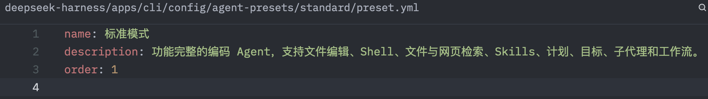
和我们普通的codex、cc使用上没有什么区别


- 提示词：
- 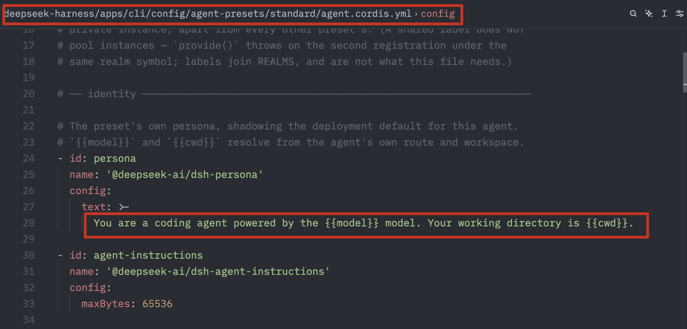


## 2.2 PTC模式


## 2.2.1 什么是 PTC

PTC（Programmatic Tool Calling）也叫 Code Mode。它让模型先生成一段临时程序，再由程序编排多个工具调用，而不是让模型逐个直接调用工具。

```text
模型生成代码
→ 调用 run_code
→ 程序调用 tools.xxx()
→ 汇总并返回结果
→ 模型继续回答
```

模型负责生成代码，Code Runtime 负责执行代码，Harness 工具负责实际操作。每个子工具调用仍经过权限、审批、沙箱、超时和日志流程。
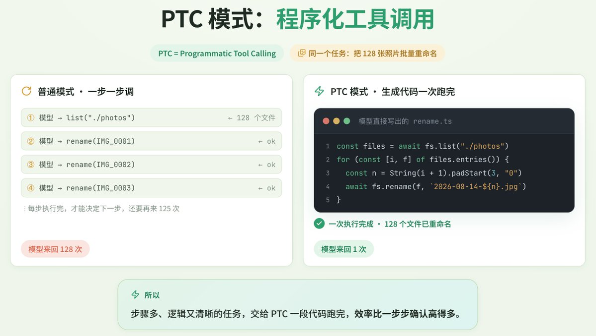


### 2.2.2、`run_code` 工具 Schema

输入和输出可以表示为：

- 1、输入
- `code`：异步 TypeScript 函数体，可以使用顶层 `await` 和 `return`。
- `description`：程序用途的简短说明，显示在 UI 中。
```ts
type RunCodeArgs = {
  code: string # `code`：异步 TypeScript 函数体，可以使用顶层 `await` 和 `return`。
  description: string
}

type RunCodeOutput = {
  logs: string[]  # 程序通过 `console.log()` 输出的字符串列表。
  result?: JsonValue # `result`：程序通过 `return` 返回的 JSON 值，可选。

}
```


例如：

```ts
console.log("找到文件")
return { count: 3 }
```

输出：

```ts
{
  logs: ["找到文件"],
  result: { count: 3 }
}
```

### 2.2.3、PTC 能编排的工具
都是 harness内部能检测到的tool
```ts
tools.read(...)
tools.write(...)
tools.edit(...)
tools.glob(...)
tools.grep(...)
tools.read_image(...)

tools.bash(...)

tools.web_search(...)
...
```

实际可用工具以当前会话生成的 `tools` SDK 声明为准。

## 2.2.4、PTC 与直接写脚本的区别

| 对比项 | PTC | 直接写脚本 |
|---|---|---|
| 定位 | 临时编排工具 | 创建真实程序 |
| 执行方式 | `run_code` 中调用 `tools.xxx()` | 通过 Bash、Node、Python 执行 |
| 权限控制 | 每个子调用进入 Harness 工具流程 | 主要依赖进程和文件沙箱 |
| 中间结果 | 可在程序内处理，只返回摘要 | 需要自行控制输出 |
| 模型往返 | 批量操作时较少 | 通常需要写入、执行、检查多步 |
| 可复用性 | 通常用于一次性任务 | 可保存、测试、提交和加入 CI |
| 运行环境 | 受限 Code Runtime | 可使用项目依赖和完整脚本生态 |

**适合 PTC：**批量读取、并行调用、搜索统计、结果过滤和一次性分析。
**适合直接写脚本：**脚本需要保存、重复运行、测试、提交 Git、加入 CI，或需要完整 Node/Python/Shell 能力。

### 2.2.5 一些实际使用

- 1、游戏开发性能比标准模式快
https://x.com/yupi996/article/2089985734010888328


## 2.3 创造模式


### 2.3.1、什么是创造模式

官方源码中的定义是：“用于创建自定义 Agent preset：具备标准模式的全部能力，并提供运行时检查、插件实验和 preset 创作指导。
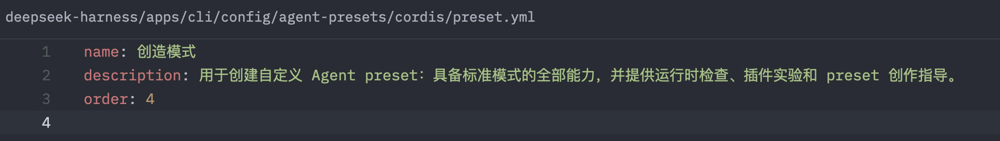


创造模式用于创建和修改 Agent 能力，而不是让模型进行文学或艺术创作。它具备标准模式的文件编辑、Shell、搜索、计划、目标、子 Agent 和工作流等能力，并增加了运行时检查、动态插件实验和自定义 Agent preset 创作能力。

可以概括为：
```text
创造模式
≈ 标准模式
+ 专用 Persona
+ tool-cordis 插件
+ 两个 Cordis Skills
```

### 2.3.2、多出来的提示词是什么


创造模式主要增加下面两部分系统提示词
- 第一部分是专用 Persona，告诉模型当前运行于 DeepSeek Harness、Harness 的能力由 Cordis 插件组成、修改时应区分 Host composition 与 Agent preset、自定义 preset 应保存到用户目录，并且不能直接修改随软件安装的内置 preset

Persona 的英文源码提示词如下：

> You are a coding agent powered by the {{model}} model, running on the DeepSeek Harness. Your working directory is {{cwd}}.
>
> You can read and modify the harness you run on. Its composition is Cordis: every capability is a plugin row in a `cordis.yml`, and an agent preset is one such file mounted for a single session.
>
> Two planes decide where an edit belongs. The HOST composition holds the registries and anything shared across sessions — persistence, the sandbox and approval stack, the model route, the subagent registry and its backends. An AGENT PRESET holds what one session contributes to those registries: its tools, its persona, its prompt sections. A row that publishes a service belongs in the host composition, or inside an `isolate` realm if the preset genuinely owns that service and nothing outside one agent reads it.
>
> Presets you author live one directory per preset under `${DSH_HOME:-$HOME/.dsh}/.agent-presets/<id>/`; the roster reports each preset's real path, so take the one you edit from there. NEVER edit or delete the shipped preset install (the `agent-presets` directory beside the deployment's own config): it belongs to the deployment, an upgrade overwrites it, and corrupting the `cordis` preset would disable this very mode. To change what a shipped preset does, copy its composition into a new preset directory and edit the copy.
>
> Load the `editing-cordis-compositions` skill before writing or changing a composition.

中文翻译如下：

> 你是一个由 {{model}} 模型驱动、运行在 DeepSeek Harness 上的编码 Agent。你的工作目录是 {{cwd}}。
>
> 你可以读取和修改自己正在运行的 Harness。它使用 Cordis 进行组装：每一项能力都是 `cordis.yml` 中的一行插件配置，而 Agent preset 就是这样一份为单个会话挂载的配置文件。
>
> 修改应放在哪里由两个平面决定。HOST composition 保存注册表以及所有跨会话共享的内容，包括持久化、沙箱与审批栈、模型路由、子 Agent 注册表及其后端。AGENT PRESET 保存单个会话向这些注册表贡献的内容，包括它的工具、Persona 和提示词片段。发布 Service 的插件行应放在 Host composition 中；如果该 Service 确实只归某个 preset 所有，并且该 Agent 之外没有任何组件读取它，也可以把它放进 preset 的 `isolate` realm 中。
>
> 你创建的 preset 按每个 preset 一个目录的方式保存在 `${DSH_HOME:-$HOME/.dsh}/.agent-presets/<id>/` 下；preset 列表会报告每个 preset 的真实路径，因此应根据该路径确定要编辑的位置。绝对不要编辑或删除随软件发布的内置 preset（部署配置旁边的 `agent-presets` 目录）：它属于当前部署，升级会覆盖它，而损坏 `cordis` preset 会导致创造模式本身不可用。如果需要修改内置 preset 的行为，应先把它的 composition 复制到一个新的 preset 目录，再编辑该副本。
>
> 在编写或修改 composition 之前，先加载 `editing-cordis-compositions` Skill。

- 第二部分由 `tool-cordis` 插件动态注入，标题为 `Dynamic Cordis Plugins`。`tool-cordis` 还会向模型注册一组 `cordis_*` 工具，因此它不只是提示词插件。下面是该插件注入的完整英文提示词。

> **Dynamic Cordis Plugins**
>
> Dynamic Cordis plugins temporarily extend the current DSH process. A Plugin uses apply(ctx) to consume Services, listen to Events, provide Services, register model Tools, or register browser UI in Slots.
>
> - Plugin and Package definitions exist only in the current process. define itself does not modify repository source, configuration, or disk, and definitions do not survive a process restart.
> - The restricted execution environment prevents accidental misuse; it is not a security boundary for malicious code. Services obtained by dynamic code connect to the real runtime.
>
> **Make the user-facing plan clear first**
>
> - Dynamic Cordis Plugins are one available implementation mechanism, not the default for every request. Consider whether one could help only when the user intends to design or create something, or when a temporary interface could materially aid the current work. The presence of these instructions or Tools, and discussion of Cordis itself, do not make a request a dynamic-Plugin task.
> - When Cordis is a plausible fit, infer the intended work target and lifetime from the request and conversation. Use it only when the outcome belongs to the current running harness and should be delivered as a temporary runtime extension. If that distinction is materially ambiguous, ask at most one concise question about the intended result or lifetime. Otherwise proceed with the matching workflow; do not require the user to know or choose Cordis as an implementation mechanism.
> - Once a dynamic Plugin is appropriate, decide whether the task creates a new Plugin or modifies the Plugin named by the user with @pluginId. Proceed directly when the goal is clear; do not ask for repeated confirmation.
> - Choose Host, Client, or both from the requested outcome. Do not propose a Client/browser UI when the task does not need visible page behavior, and do not avoid Client when the requested outcome is visual, interactive, or depends on page state. Host versus Client is an implementation choice; do not make the user choose it.
> - When a design direction or a potentially useful interface would materially affect the result, ask at most one concise outcome or creative-preference question and offer a few candidate directions. Otherwise proceed directly; do not conduct a multi-round interview or a complex questionnaire.
> - cordis_define only defines and presents code; it does not run it. After definition, explain the pluginId and packageId returned by the Host and whether the next step is a run or update.
> - cordis_run may require user approval. When it returns awaiting-approval, explain that the user must allow or reject it in the UI. Do not wait, retry, or claim that it is running.
> - When it returns starting, explain that the request has entered the asynchronous flow and the Client is still activating. starting does not mean success. Wait for the system to report the final result through steering context.
> - Do not request approval again after the user rejects it. After a technical failure, fix the same Plugin from its diagnostics; do not silently create a replacement Plugin.
>
> **Recommended workflow and Tools**
>
> Before creating, modifying, or repairing a Plugin, load the cordis-plugin-development Skill. The Skill provides requirement navigation, capability composition, complete examples, and troubleshooting. Treat Inspect Provider results as the source of truth for exact APIs.
>
> 1. cordis_inspect_list: discover the current Host and Client Providers and their read-only query methods.
> 2. cordis_inspect_query: use the returned platform, provider, method, and schema to query exact Service, Event, Builtin, Slot, Theme token, or Tool information.
> 3. cordis_inspect_self: inspect the current Session's Plugins, Packages, version pointers, source, and diagnostics. Source is returned only when both pluginId and packageId are specified.
> 4. cordis_define: create the first Package for a new Plugin or append an immutable Package to an existing Plugin. It defines code but does not run it.
> 5. cordis_run: activate an exact Package. Use run for the first activation, restarting current, or rollback; use update to switch versions.
> 6. cordis_stop: remove the current Run and pending approval request while retaining definitions, grants, and version pointers.
> 7. cordis_undefine: permanently stop and delete a Plugin and all of its Packages. Use it only after confirming that the user no longer needs them.
>
> - Inspect and Catalog data only confirm capabilities, names, signatures, types, and registration protocols before code is written; they do not replace business APIs.
> - Query Service.listService and Event.listEvents without input to choose from their compact signature directories, then query the exact service or event before using it. Exact queries return the structured contract and only its referenced types.
> - At runtime, a Plugin must call real Services or listen to real Events. Do not cache, display, or depend on Inspect results as business data.
>
> **Identity, versions, and approval**
>
> - pluginId identifies a Plugin that can be modified over time. For a new Plugin, submit only a semantic idPrefix of 3–6 lowercase English letters; the Host allocates the final ID.
> - packageId identifies one immutable Host/Client source version under a Plugin. To change code, define a new Package; never overwrite an old version.
> - pluginRunId identifies one activation attempt and connects its approval, Host/Client loading, private RPC, Run card, and errors.
> - currentPackageId is the most recent fully successful Package. Stopping, starting an update, or failing an update does not clear it.
> - nextPackageId is the target awaiting approval, being attempted, awaiting Client activation, or most recently failed.
> - A single check mark authorizes only the current Package; double check marks authorize future versions of the same Plugin. A grant remains in effect after a technical failure.
> - An update stops the old Run before starting the target Package. Failure does not automatically restart the old version; retry next with update or roll back to current with run.
>
> When the user enters @pluginId, the system injects identity, the default base Package, version pointers, and runtime status, but not source code:
>
> 1. Call cordis_inspect_self(pluginId, packageId) to read the target source.
> 2. Use cordis_define in existing mode to append a Package to the same Plugin.
> 3. Call cordis_run in run or update mode according to the version relationship.
>
> Never silently create another Plugin for @pluginId. If the reference is unavailable because it was removed, belongs to another Session, or was lost on process restart, tell the user directly.
>
> **High-frequency errors that must be avoided**
>
> **Services: ctx.get and inject**
>
> - Read an optional Service with ctx.get('serviceName') by default and handle undefined.
> - Declare inject: ['serviceName'] on the returned Plugin object only when the Service is a hard dependency and the Plugin must enter waiting until Cordis reactivates it after the Service appears.
> - Read ctx.serviceName only after declaring that Service in inject. Never access an undeclared Service as a ctx property.
>
> ```js
> return {
>   inject: ['requiredService'],
>   apply(ctx) {
>     ctx.requiredService.someMethod()
>     const optionalService = ctx.get('optionalService')
>     if (optionalService !== undefined) optionalService.someMethod()
>   },
> }
> ```
>
> **Code: use plain JavaScript only**
>
> - Host and Client code is not transformed by TypeScript, JSX, or a bundler.
> - Do not use TypeScript types, as, decorators, import, require, or JSX.
> - Client React code must use React.createElement(...); never write `<Component />`.
> - Do not assume that process, Buffer, window, document, fetch, native timers, or any other global is available. Query the corresponding platform's Builtins and Services first.
>
> **Data: do not serialize live data**
>
> - Services, Events, Slots, Sessions, and their derived Cordis/DSH objects are internal live data, not ordinary JSON that can be dumped.
> - Do not apply JSON.stringify, structuredClone, recursive enumeration, full copying, or whole-object display to live data.
> - Read only the leaf fields required by the task, then construct the smallest owned data object without Host references.
>
> **Lifecycle: every side effect must be reversible**
>
> - Services, Events, Tools, handlers, timers, Slots, styles, and theme overrides must all belong to the current Fiber.
> - Use ctx.effect(), ctx.on(), or official APIs that return a disposer so stop, update, or undefine removes every side effect.
> - The cordis-plugin-development Skill contains complete timer, Waterfall, Slot, theme, Tool, RPC, and React examples and troubleshooting guidance.
>
> **Host and Client**
>
> - Host runs in the DSH Node.js process and is appropriate for files, networking, commands, Agent/Session access, Host Events, Services, model Tools, and JSON methods callable by the Client.
> - Client runs in the browser page and is appropriate for themes, layout, current page state, Tool cards, and Slot UI.
> - Host and Client communicate through Package-private JSON methods: Host uses harness.handle(method, handler), and Client uses host.call(method, args). The direction is Client→Host, and only lossless JSON may cross it.
> - Client UI must be registered in a queried Slot; apply() cannot directly return a React Element. Query Slots.listSubTree without root to choose from the compact purpose/topology tree, then query the exact root for its full registration contract and props before writing code.
> - See the Skill and Inspect Providers for Run-specific panels and exact Slot registration patterns.
>
> **Asynchronous results and recovery**
>
> - Do not wait inside a Tool for approval or browser work that can happen only after the current turn ends.
> - Asynchronous success, rejection, and runtime errors update Run state and notify you through steering context.
> - After a technical failure, use cordis_inspect_self to read the exact Package source and its message/stack. Define a corrected Package under the same Plugin and retry autonomously.
> - Use the cordis-plugin-development Skill for other failure causes, repair procedures, and complete extension patterns.


下面是 `tool-cordis` 系统提示词的中文翻译：

> **动态 Cordis 插件**
>
> 动态 Cordis 插件用于临时扩展当前 DSH 进程。插件通过 `apply(ctx)` 使用 Service、监听 Event、提供 Service、注册模型 Tool，或在 Slot 中注册浏览器 UI。
>
> - Plugin 和 Package 定义只存在于当前进程中。`define` 本身不会修改仓库源码、配置或磁盘，进程重启后这些定义不会保留。
> - 受限执行环境用于防止意外误用，并不是抵御恶意代码的安全边界。动态代码获得的 Service 会连接真实运行时。
>
> **首先向用户明确实施方案**
>
> - 动态 Cordis 插件只是可选实现方式之一，并非每项请求的默认方案。只有当用户要设计或创建某项内容，或者临时界面能实质帮助当前工作时，才考虑使用动态插件。这些指令或工具的存在，以及对 Cordis 本身的讨论，都不会自动使一个请求成为动态插件任务。
> - 当 Cordis 可能适用时，应根据请求和对话推断目标及其生命周期。只有当结果属于当前运行中的 Harness，并且适合作为临时运行时扩展交付时，才使用动态插件。如果这一区别存在实质性歧义，最多询问一个关于目标或生命周期的简洁问题；否则直接采用匹配的流程，不要求用户了解或选择 Cordis 作为实现机制。
> - 确定适合使用动态插件后，判断任务是创建新 Plugin，还是修改用户通过 `@pluginId` 指定的 Plugin。目标明确时直接执行，不要反复请求确认。
> - 根据结果选择 Host、Client 或两者。任务不需要可见页面行为时，不要提出 Client/浏览器 UI；任务具有视觉性、交互性或依赖页面状态时，也不要回避 Client。Host 与 Client 的选择属于实现决策，不应交给用户选择。
> - 如果设计方向或可能有用的界面会实质影响结果，最多询问一个简洁的目标或创意偏好问题，并提供几个候选方向；否则直接执行，不要进行多轮访谈或复杂问卷。
> - `cordis_define` 只定义并展示代码，不会运行代码。定义完成后，应说明 Host 返回的 `pluginId` 和 `packageId`，并说明下一步应执行 run 还是 update。
> - `cordis_run` 可能需要用户审批。当它返回 `awaiting-approval` 时，应说明用户必须在 UI 中允许或拒绝；不要等待、重试或声称插件正在运行。
> - 当它返回 `starting` 时，应说明请求已经进入异步流程，Client 仍在激活。`starting` 不代表成功，应等待系统通过 steering context 报告最终结果。
> - 用户拒绝后不要再次请求审批。发生技术故障后，应根据诊断修复同一个 Plugin，不要悄悄创建替代 Plugin。
>
> **推荐流程与工具**
>
> 创建、修改或修复 Plugin 之前，先加载 `cordis-plugin-development` Skill。该 Skill 提供需求导航、能力组合、完整示例和故障排查。精确 API 必须以 Inspect Provider 的查询结果为准。
>
> 1. `cordis_inspect_list`：发现当前 Host 和 Client Inspect Provider 及其只读查询方法。
> 2. `cordis_inspect_query`：使用返回的 platform、provider、method 和 schema，查询准确的 Service、Event、Builtin、Slot、Theme token 或 Tool 信息。
> 3. `cordis_inspect_self`：检查当前 Session 的 Plugin、Package、版本指针、源码和诊断信息。只有同时指定 `pluginId` 与 `packageId` 时才返回源码。
> 4. `cordis_define`：为新 Plugin 创建第一个 Package，或给现有 Plugin 追加不可变 Package。它只定义代码，不运行代码。
> 5. `cordis_run`：激活指定 Package。首次激活、重新启动当前版本或回滚时使用 run；切换版本时使用 update。
> 6. `cordis_stop`：移除当前 Run 并取消待处理的审批请求，同时保留定义、授权和版本指针。
> 7. `cordis_undefine`：永久停止并删除 Plugin 及其全部 Package。只有确认用户不再需要它们时才使用。
>
> - Inspect 和 Catalog 数据只用于在编写代码前确认能力、名称、签名、类型和注册协议，不能代替业务 API。
> - 查询 `Service.listService` 和 `Event.listEvents` 时先不传输入，从精简签名目录中选择，再针对具体 Service 或 Event 查询。精确查询会返回结构化约定及其引用的类型。
> - Plugin 运行时必须调用真实 Service 或监听真实 Event。不要把 Inspect 结果作为业务数据进行缓存、展示或依赖。
>
> **身份、版本与审批**
>
> - `pluginId` 标识一个可持续修改的 Plugin。创建新 Plugin 时，只提交由 3～6 个小写英文字母组成的语义前缀 `idPrefix`，最终 ID 由 Host 分配。
> - `packageId` 标识某个 Plugin 下不可变的一版 Host/Client 源码。修改代码时必须定义新 Package，绝不能覆盖旧版本。
> - `pluginRunId` 标识一次激活尝试，并把审批、Host/Client 加载、私有 RPC、Run 卡片和错误关联起来。
> - `currentPackageId` 是最近一次完全成功的 Package。停止、开始更新或更新失败都不会清除它。
> - `nextPackageId` 是正在等待审批、尝试激活、等待 Client 激活或最近失败的目标版本。
> - 单个对勾只授权当前 Package；双对勾授权同一 Plugin 的后续版本。技术故障不会使已有授权失效。
> - update 会在启动目标 Package 前停止旧 Run。更新失败不会自动重启旧版本；下一步可以用 update 重试目标版本，或用 run 回滚到 current 版本。
>
> 当用户输入 `@pluginId` 时，系统会注入 Plugin 身份、默认基础 Package、版本指针和运行状态，但不会注入源码：
>
> 1. 调用 `cordis_inspect_self(pluginId, packageId)` 读取目标源码。
> 2. 使用 existing 模式调用 `cordis_define`，给同一个 Plugin 追加 Package。
> 3. 根据版本关系，以 run 或 update 模式调用 `cordis_run`。
>
> 不要为 `@pluginId` 悄悄创建另一个 Plugin。如果引用因已被删除、属于其他 Session 或在进程重启后丢失而不可用，应直接告诉用户。
>
> **必须避免的高频错误**
>
> **Service：`ctx.get` 与 `inject`**
>
> - 默认使用 `ctx.get('serviceName')` 读取可选 Service，并处理 `undefined`。
> - 只有当某个 Service 是硬依赖，而且缺失时 Plugin 必须进入等待状态、待 Service 出现后由 Cordis 重新激活，才在返回的 Plugin 对象上声明 `inject: ['serviceName']`。
> - 只有声明了相应 Service 的 `inject` 后，才能读取 `ctx.serviceName`。绝不能把未声明的 Service 作为 `ctx` 属性访问。
>
> ```js
> return {
>   inject: ['requiredService'],
>   apply(ctx) {
>     ctx.requiredService.someMethod()
>     const optionalService = ctx.get('optionalService')
>     if (optionalService !== undefined) optionalService.someMethod()
>   },
> }
> ```
>
> **代码：只能使用普通 JavaScript**
>
> - Host 和 Client 代码不会经过 TypeScript、JSX 或打包器转换。
> - 不要使用 TypeScript 类型、`as`、装饰器、`import`、`require` 或 JSX。
> - Client React 代码必须使用 `React.createElement(...)`，不能写 `<Component />`。
> - 不要假定 `process`、`Buffer`、`window`、`document`、`fetch`、原生定时器或其他全局对象可用。必须先查询对应平台的 Builtin 和 Service。
>
> **数据：不要序列化运行时对象**
>
> - Service、Event、Slot、Session 及其派生的 Cordis/DSH 对象是内部运行时数据，不是可以直接转储的普通 JSON。
> - 不要对运行时对象使用 `JSON.stringify`、`structuredClone`、递归枚举、完整复制或整对象显示。
> - 只读取任务需要的叶子字段，然后构造不包含 Host 引用的最小自有数据对象。
>
> **生命周期：所有副作用都必须可撤销**
>
> - Service、Event、Tool、处理器、定时器、Slot、样式和主题覆盖都必须归当前 Fiber 所有。
> - 使用 `ctx.effect()`、`ctx.on()` 或返回 disposer 的官方 API，确保 stop、update 或 undefine 能清除所有副作用。
> - `cordis-plugin-development` Skill 包含定时器、Waterfall、Slot、主题、Tool、RPC 和 React 的完整示例及故障排查说明。
>
> **Host 与 Client**
>
> - Host 运行在 DSH 的 Node.js 进程中，适合处理文件、网络、命令、Agent/Session 访问、Host Event、Service、模型 Tool，以及可由 Client 调用的 JSON 方法。
> - Client 运行在浏览器页面中，适合处理主题、布局、当前页面状态、Tool 卡片和 Slot UI。
> - Host 与 Client 通过 Package 私有 JSON 方法通信：Host 使用 `harness.handle(method, handler)`，Client 使用 `host.call(method, args)`。方向是 Client→Host，并且只能传输无损 JSON。
> - Client UI 必须注册到查询得到的 Slot 中；`apply()` 不能直接返回 React Element。编写代码前，先不指定 root 查询 `Slots.listSubTree`，从精简用途/拓扑树中选择，再针对具体 root 查询完整注册约定和 props。
> - Run 专属面板和精确 Slot 注册方式请参考 Skill 与 Inspect Provider。
>
> **异步结果与故障恢复**
>
> - 不要在 Tool 内等待只能在当前轮结束后发生的审批或浏览器操作。
> - 异步成功、拒绝和运行时错误会更新 Run 状态，并通过 steering context 通知 Agent。
> - 发生技术故障后，使用 `cordis_inspect_self` 读取准确的 Package 源码、错误消息和堆栈。在同一 Plugin 下定义修正版 Package，并自主重试。
> - 其他失败原因、修复流程和完整扩展模式请参考 `cordis-plugin-development` Skill。


### 2.3.3、多出来的 2 个 Skill
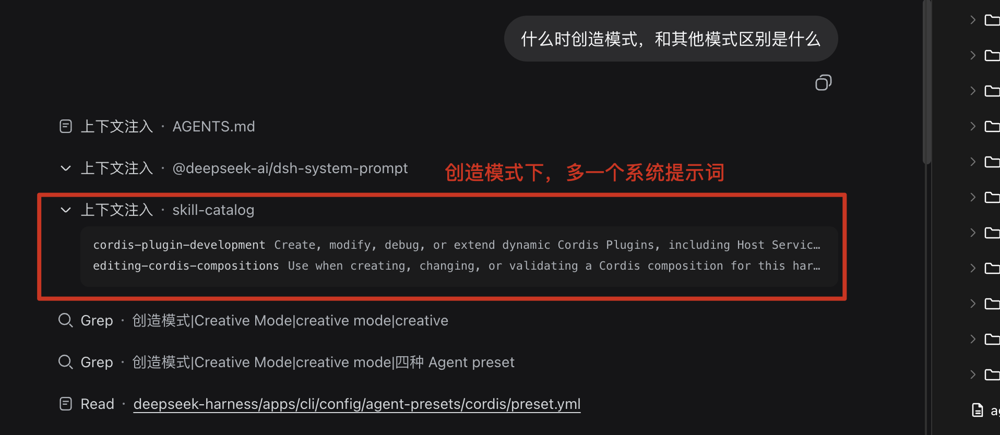
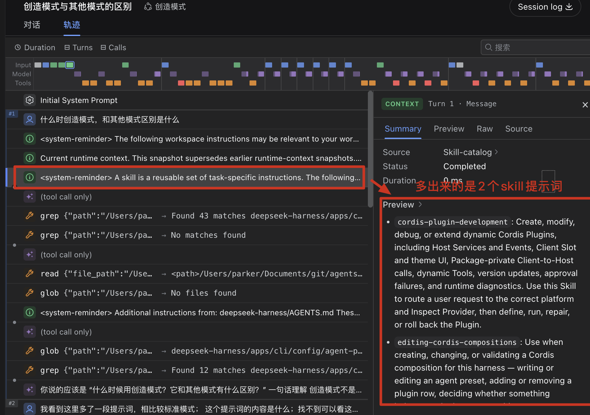
我们从聊天界面上看到的是比标准模式多了一段上下文

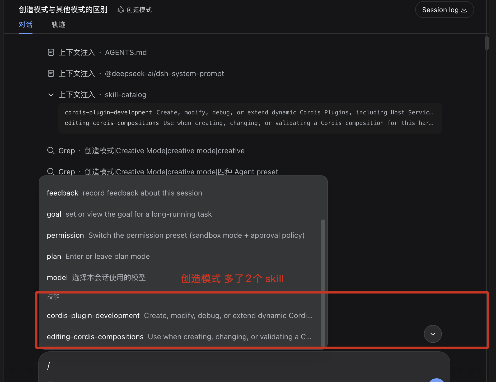

1. **`cordis-plugin-development`**：指导动态 Cordis 插件开发，包括运行时检查、Host/Client 插件、工具注册、浏览器 UI、版本更新、审批和故障修复。
2. **`editing-cordis-compositions`**：指导 Agent preset 和 `cordis.yml` 的创建、修改与验证，并帮助判断插件应放在 Host composition 还是 Agent preset 中。

这两个 Skill 的完整内容不会一直加入系统提示词，而是在任务需要时由 Agent 加载。

### 2.3.4、能输出的产物

创造模式主要能产生两类产物：

1. **动态 Cordis 插件**：可以临时添加模型工具、Host 服务、事件处理、浏览器面板、按钮、主题和样式。
2. **自定义 Agent preset**：可以定制 Persona、系统提示词、工具、Skills、子 Agent、工作流和上下文能力，并作为新的 Agent 模式供后续会话选择。

### 2.3.5、适用场景和时效性

创造模式适合开发或调试 DSH/Cordis 插件、给当前 DSH 临时增加工具或界面、检查运行时能力，以及创建可长期使用的自定义 Agent preset。普通编码、修复 Bug、写文档和研究任务通常使用标准模式即可。

动态 Cordis 插件只存在于当前 DSH 宿主进程中。停止后可以在同一进程内重新运行，但宿主进程重启后，插件定义、版本和运行状态都会消失，不能自动恢复。

自定义 Agent preset 会保存到 `${DSH_HOME:-$HOME/.dsh}/.agent-presets/<id>/`。它是磁盘上的持久化配置，DSH 重启后仍然存在，并可在以后新建会话时继续选择。

```text
动态 Cordis 插件：临时产物，宿主进程重启后消失
自定义 Agent preset：持久产物，宿主进程重启后仍然存在
```


### 2.3.6 实操开发1个UI插件
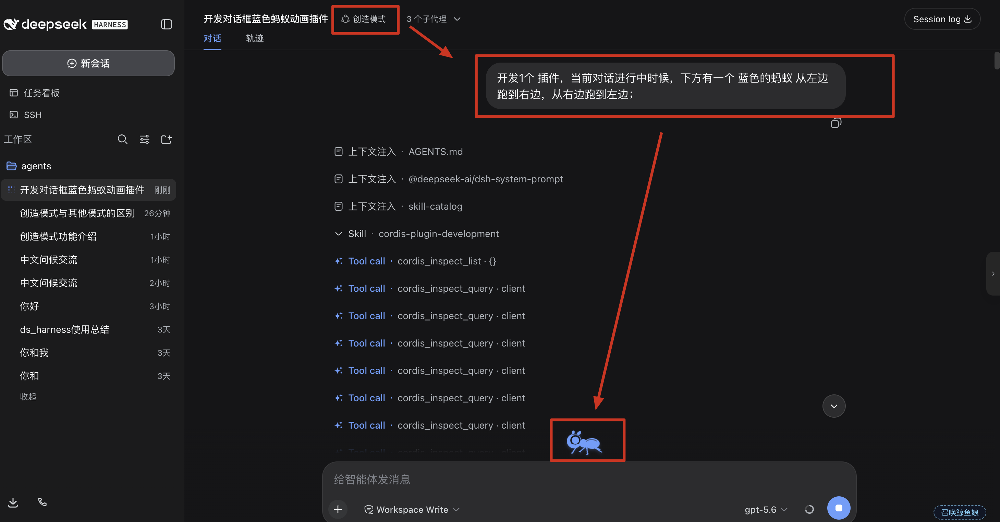
在创造模式下直接和harness 对话就可以开发一个你想要的插件改变UI，当前ds harness宣称everything is a plugin, 所以你想开发任意插件都可以。

## 2.4 这些模式在源码里面的配置


## 第三章 官方三大特性体验及原理

### 3.1 一切皆插件


#### 3.1.1 官方插件体验

DeepSeek Harness 基于 [Cordis](https://github.com/cordiverse/cordis) 插件系统构建。模型、工具、技能、会话、沙箱、存储、循环、调度、UI 等所有 Agent 能力均由插件提供，并通过 Cordis 服务与事件彼此协作。开发者无需改动 DeepSeek Harness 源码，即可在配置层选择、替换或扩展任一能力。


- 源码怎么定义插件


下面安排四个独立实验，分别验证本地插件、模型工具和 Provider 配置热更新；第四个实验从可构建源码到其他用户按包名安装的发布链路。

四个实验使用三种启动方式，对应插件从开发到交付的不同阶段：
| 阶段 | 对应章节 | 配置怎样进入运行时 | 为什么采用这种方式 |
| --- | --- | --- | --- |
| 在 Web 中调试本地源码 | 3.1.2、3.1.3 | `pnpm dsh web --patch <文件>` 在本次启动中临时叠加一份 patch | 不安装插件，不修改 Profile，停止进程后这份临时叠加就结束 |
| 在完整 Web 中验证配置热更新 | 3.1.4 | 把实验配置加入 Web Profile 自己的 `cordis.patch.yml` | Web 持续监听这份 Profile patch；保存后重新组合变化的插件，页面和其他插件继续运行 |
| 安装并交付插件 | 3.1.5 | `dsh plugin add` 读取 npm 包内的 Bundle Patch，并把 Bundle 加入 Web Profile | 安装完成后，正常执行 `pnpm dsh web` 就会加载插件，不必每次手写 `--patch` |

四个实验也可以在第三章交互式 Workshop 中逐步执行。它保留真实执行按钮和流式终端，切换实验不会停止其他步骤中正在运行的 Web：

```sh
node parker/tutorial-labs/workshop/workshop-server.mjs
```

启动后打开 `http://127.0.0.1:3090`。


#### 3.1.2 动手开发 1 个 Hello 日志打印插件

本实验依据官方教程[《第一个插件》](https://deepseek-harness.github.io/deepseek-harness/develop/basic/)。目标是在不修改 Harness 源码的情况下，通过一次性 patch 加载本地 TypeScript 插件，并从终端确认 Cordis 已经调用它的 `apply(ctx)`。

**第一步：创建本地项目。** 从已经能够通过源码运行 DeepSeek Harness 的仓库检出开始，在仓库根目录执行：

```sh
mkdir -p parker/tutorial-labs/plugin-workshop/00-first-plugin/src
```

**第二步：写出最小插件。** 创建 `parker/tutorial-labs/plugin-workshop/00-first-plugin/src/my-plugin.ts`：

```ts
import type { Context } from '@deepseek-ai/cordis'

export const name = 'hello-plugin'

export function apply(ctx: Context) {
  // Required dependencies are ready before apply runs.
  console.log('[hello-plugin] plugin loaded!')
}
```

此时插件只有一个可观察结果：Cordis 加载模块后调用 `apply(ctx)`，终端打印一行日志。

**第三步：把插件插入 Web 配置。** 在仓库根目录运行 `pwd`，复制输出的绝对路径。创建 `parker/tutorial-labs/plugin-workshop/00-first-plugin/cordis.yml`，并把示例路径替换为刚才得到的路径：

```yaml
- insert:
    - id: hello
      name: '/absolute/path/to/deepseek-harness/parker/tutorial-labs/plugin-workshop/00-first-plugin/src/my-plugin.ts'
```

这里必须使用绝对路径。patch 文件贡献的是一段配置；Loader 解析模块路径时仍以 Profile 目录为基准，因此相对路径不会以实验目录中的 `cordis.yml` 为基准。

**第四步：启动并验收最小插件。** 使用刚创建的覆盖层启动 Web：

```sh
pnpm dsh web --patch ./parker/tutorial-labs/plugin-workshop/00-first-plugin/cordis.yml
```

打开 `http://127.0.0.1:3080`。启动期间，终端应出现：

```text
[hello-plugin] plugin loaded!
```

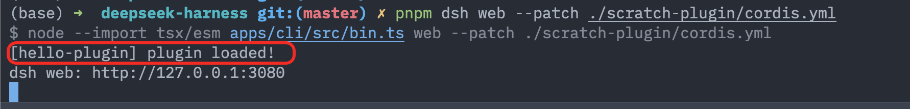

实际运行结果与官方教程一致：启动命令进入源码启动器后，终端先打印 `[hello-plugin] plugin loaded!`，随后给出 Web 地址 `http://127.0.0.1:3080`。这说明 Loader 已经解析 patch 中的绝对模块路径、导入 `my-plugin.ts` 并调用 `apply(ctx)`，从 TypeScript 模块、Cordis 配置到运行中插件的最小闭环已经成立。

完成截图后停止当前 Web 进程。后续实验使用自己的源码和 patch，不再加载 `00-first-plugin/cordis.yml`。

#### 3.1.3 动手开发 1 个 Greet Tool 插件

本实验依据官方教程[《开发一个工具》](https://deepseek-harness.github.io/deepseek-harness/develop/basic/tool)。它不会修改 3.1.2 的文件，而是创建一个独立插件；启动时只加载本实验的自定义 patch。

**第一步：创建独立项目。** 在仓库根目录执行：

```sh
mkdir -p parker/tutorial-labs/plugin-workshop/01-simple-greet-tool/src
```

**第二步：创建工具插件。** 将下面的实现保存为 `parker/tutorial-labs/plugin-workshop/01-simple-greet-tool/src/greet-tool.ts`：

```ts
import type { Context } from '@deepseek-ai/cordis'
import { defineTool } from '@deepseek-ai/dsh-tools'

export const name = 'greet-tool'
export const inject = ['tools']

export function apply(ctx: Context) {
  ctx.tools.register(defineTool({
    name: 'greet',
    description: 'Greet someone by name.',
    parameters: {
      name: { type: 'string', required: true, description: 'The name to greet' },
    },
    output: {
      schema: { type: 'string' },
      render: (_args, value) => [{ type: 'text', text: value }],
    },
    async execute(args) {
      return `Hello, ${args.name}!`
    },
  }))
}
```

**第三步：创建独立 patch。** 将仓库绝对路径写入 `parker/tutorial-labs/plugin-workshop/01-simple-greet-tool/cordis.yml`：

```yaml
- insert:
    - id: greet-tool
      name: '/absolute/path/to/deepseek-harness/parker/tutorial-labs/plugin-workshop/01-simple-greet-tool/src/greet-tool.ts'
```

**第四步：启动并调用工具。** 使用本实验自己的 patch 启动：

```sh
pnpm dsh web --patch ./parker/tutorial-labs/plugin-workshop/01-simple-greet-tool/cordis.yml
```

打开 `http://127.0.0.1:3080`，输入：

```text
Use the greet tool to greet Ada.
```

模型可以调用 `greet`，工具执行后返回 `Hello, Ada!`。本实验结束后停止当前进程；3.1.2 的 `hello-plugin` 不会出现在这次启动中。

#### 3.1.4 在 Web 中热更新 1 个模拟 Provider

本实验依据官方[《插件配置》](https://deepseek-harness.github.io/deepseek-harness/develop/basic/config)、[《组合与 HMR》](https://deepseek-harness.github.io/deepseek-harness/develop/cordis-tutorial/06-composition-and-hmr)和[CLI Profile 启动参考](https://github.com/deepseek-ai/DeepSeek-Harness/blob/master/apps/cli/reference/README.zh.md)，目标是在完整的 DeepSeek Harness Web 中修改模拟 Provider 的 `apiKey` 与 `baseURL`，从 Web 进程日志观察旧 Provider 和 Consumer 卸载后按新配置恢复。浏览器页面、模型配置和默认 Web 插件在整个实验中保持运行。

3.1.2、3.1.3 传给 `--patch` 的是一次性启动覆盖层：Web 只在启动时读取，保存该文件不会触发热更新。
本节改用 Web Profile 自己的 `cordis.patch.yml`；长时间运行的 Web 会持续监听这份用户配置并重新组合变化的插件。因此本实验正常启动 Web，不再传 `--patch`。

**先认识 Web Profile。** Profile 是一套可启动的插件组合；`pnpm dsh web` 是 `pnpm dsh --profile web` 的别名，两条命令都会加载名为 `web` 的 Profile。这里的插件组合包（Bundle）不是某一个运行中的 Plugin，而是一个可安装的 npm 包：它在 `package.json` 中用 `dsh.bundle.patch` 指向随包提供的 `cordis.patch.yml`，这份 patch 可以一次插入、配置或禁用多个 Plugin。Profile 按顺序列出若干 Bundle，再叠加用户 patch，最终得到本次启动的插件树。

三者的关系可以直接记为：Plugin 是一项运行时能力，Bundle 负责打包一组插件配置，Profile 负责选择若干 Bundle 并启动组合出的插件树。本课程使用的 Web Profile 位于 `~/.dsh/profiles/web`，其中包含四个文件：

```text
~/.dsh/profiles/web/
├── package.json
├── cordis.yml
├── cordis.patch.yml
└── pnpm-workspace.yaml
```

| 文件 | 当前职责 | 本实验是否修改 |
| --- | --- | --- |
| `package.json` | Profile 清单；`dsh.profile.bundles` 选择组成 Web 的插件组合包 | 否 |
| `cordis.yml` | Loader 所需的空根配置，由启动器维护和重写 | 否 |
| `cordis.patch.yml` | 用户可编辑的 Profile patch，覆盖 Bundle 配置或插入额外插件 | 是 |
| `pnpm-workspace.yaml` | Profile 安装外部 npm 插件时使用的 pnpm 工作区配置 | 否 |


修改 `cordis.patch.yml` 能触发热更新。相比之下，`--patch <文件>` 是本次进程额外叠加的启动覆盖层，启动器不会为这个任意文件注册实时监听，所以 3.1.2、3.1.3 保存各自的 `cordis.yml` 不会触发上述流程。

**第一步：打开 Web Profile 的用户 patch。** 用编辑器打开 `~/.dsh/profiles/web/cordis.patch.yml`

**第二步：把实验配置加入 Profile patch。**
```yaml
- insert:
    - id: tutorial-mock-provider
      name: '/absolute/path/to/deepseek-harness/parker/tutorial-labs/plugin-workshop/03-provider-config-hmr/mock-provider.ts'
      config:
        apiKey: 'demo-key-BEFORE-HMR-OLD1'
        baseURL: 'https://provider-before-hot-reload.invalid/api/v1/legacy-region'
    - id: tutorial-provider-consumer
      name: '/absolute/path/to/deepseek-harness/parker/tutorial-labs/plugin-workshop/03-provider-config-hmr/provider-consumer.ts'
```


```sh
pnpm dsh --profile web --dump-config
```

**第三步：启动完整 Web。** 正常启动
```sh
pnpm dsh web
```

启动后终端会同时给出插件日志和 Web 地址：
```text
[mock-provider] loaded baseURL=https://provider-before-hot-reload.invalid/api/v1/legacy-region apiKey=demo...OLD1
[provider-consumer] using https://provider-before-hot-reload.invalid/api/v1/legacy-region
dsh web: http://127.0.0.1:3080
```

打开终端给出的地址，确认完整 Web 页面可以正常访问。Provider 注册 `mockProvider` Service，Consumer 通过 `inject = ['mockProvider']` 等待并使用它；本实验不需要向模型发送消息。

**第四步：保持 Web 运行并修改参数。** 回到第一步已经打开的 `cordis.patch.yml`，把同一配置项改为第二组假参数并保存：

```yaml
config:
  apiKey: 'demo-key-AFTER-HMR-NEW2'
  baseURL: 'https://provider-after-hot-reload.invalid/api/v2/new-region'
```

这次修改同时改变域名前缀（`before-hmr` → `after-hmr`）、接口版本（`v1` → `v2`）和 API Key 脱敏后仍可见的尾部（`OLD1` → `NEW2`）。HMR 根据稳定 `id` 重配该项，实际输出如下：

```text
[mock-provider] disposed baseURL=https://provider-before-hot-reload.invalid/api/v1/legacy-region
[provider-consumer] detached
[mock-provider] loaded baseURL=https://provider-after-hot-reload.invalid/api/v2/new-region apiKey=demo...NEW2
[provider-consumer] using https://provider-after-hot-reload.invalid/api/v2/new-region
```

不重启 Web，再次访问原地址仍能得到页面。Provider 消失期间，声明硬依赖的 Consumer 自动卸载；新服务出现后 Consumer 自动恢复。API Key 只使用假值并脱敏打印。真实 Provider 不应把密钥写入日志，生产插件通常保存凭据引用，并在请求时解析凭据。

**第五步：清理实验配置。** 从 `~/.dsh/profiles/web/cordis.patch.yml` 中删除刚才加入的整个 `insert` 条目并保存；如果文件中没有其他条目，恢复为 `[]`。同一个 Web 进程会打印：

```text
[mock-provider] disposed baseURL=https://provider-after-hot-reload.invalid/api/v2/new-region
[provider-consumer] detached
```

Web 页面继续运行，但本节的两个插件已经移除。至此，本实验既验证了完整 Web 中的 Provider 配置热更新，也恢复了开始实验前的插件组合。


#### 3.1.5 打包并发布 1 个蚂蚁 UI 插件

本实验依据官方[《打包与安装插件》](https://deepseek-harness.github.io/deepseek-harness/develop/basic/publish)，使用已经完成的 `dsh-running-ant`，不展开 React 组件、动画和 Slot 接入的开发过程。插件在当前会话生成期间显示一只往返爬行的蓝色蚂蚁，生成结束后自动隐藏；它不修改系统提示词，不注册模型工具，不发送网络请求，也不写入 Session Log。

本节进入插件交付阶段：3.1.2、3.1.3 直接从绝对路径加载 TypeScript 源码，适合本机调试；要让别人安装，插件必须成为一个自包含的 npm 包。插件工作区位于 `parker/ds_plugin/`，参与发布的源码包在 `parker/ds_plugin/plugins/dsh-running-ant/`，打包结果输出到 `parker/ds_plugin/dist/`。

这里的 **npm 安装包** 是一个以 `.tgz` 结尾的压缩文件，npm 和 pnpm 文档也称它为 tarball。它不是另一份源码目录，而是 `pnpm pack` 按 `package.json` 的发布规则收集出的成品，里面应当只有使用者安装插件所需的 JavaScript、类型声明、Bundle Patch、说明和许可证。发布到 npm Registry 的也是同一组文件。

打包前首先检查 `package.json` 的四组关键声明：

```json
{
  "name": "dsh-running-ant",
  "version": "0.1.0",
  "main": "lib/index.js",
  "files": [
    "lib/**/*.js",
    "lib/**/*.js.map",
    "lib/**/*.d.ts",
    "lib/**/*.d.ts.map",
    "cordis.patch.yml",
    "README.md",
    "LICENSE"
  ],
  "scripts": {
    "prepack": "pnpm build"
  },
  "dsh": {
    "bundle": { "patch": "./cordis.patch.yml" },
    "client": {
      "inject": [
        "@deepseek-ai/dsh-client-runtime",
        "@deepseek-ai/dsh-client-ui-conversation"
      ],
      "platform": "web"
    }
  }
}
```

`prepack` 保证打包和发布前生成 `lib/`；`files` 是进入 npm 包的白名单；`dsh.bundle.patch` 让 `dsh plugin add` 把插件加入目标 Profile；`dsh.client` 告诉 Web ModuleLoader 加载浏览器端产物。随包发布的 `cordis.patch.yml` 使用 npm 包名，而不是开发机上的源码路径：

```yaml
- insert:
    - id: ui-running-ant
      name: dsh-running-ant
```

**第一步：测试并生成 `.tgz` 安装包。** 在仓库根目录执行：

```sh
cd parker/ds_plugin
pnpm install
pnpm --filter dsh-running-ant typecheck
pnpm --filter dsh-running-ant test
pnpm pack:running-ant
```

最后一条命令会先执行 `prepack` 构建插件，再生成 npm 安装包 `parker/ds_plugin/dist/dsh-running-ant-0.1.0.tgz`。发布前检查这个 `.tgz` 成品，而不是只检查源码目录：

```sh
tar -tzf dist/dsh-running-ant-0.1.0.tgz
```

输出至少应包含 `package.json`、`cordis.patch.yml`、`lib/index.js`、`lib/client.js`、`README.md` 和 `LICENSE`。Host 空入口、浏览器插件、Bundle Patch 三者缺少任意一个，安装后都不能形成完整的 Web 插件。

**第二步：用 `.tgz` 安装包完成发布前验收。** 回到 Harness 仓库根目录，把这个本地安装包加入 Web Profile：

```sh
cd ../..
pnpm dsh plugin --profile web add \
  file:/absolute/path/to/deepseek-harness/parker/ds_plugin/dist/dsh-running-ant-0.1.0.tgz
pnpm dsh --profile web --dump-config
```

最终配置中应出现：

```yaml
# == dsh-running-ant
- id: ui-running-ant
  name: dsh-running-ant
```

这一步没有使用 `--patch`，因为 `plugin add` 已经完成了两件事：安装 `.tgz` 中的 npm 包，并根据包内 `dsh.bundle.patch` 把 `dsh-running-ant` 加入 Web Profile。此后每次正常启动该 Profile 都会组合这个 Bundle；只有尚未安装的本地源码实验才需要通过 `--patch` 临时加入。

再执行 `pnpm dsh web`，新建会话并发送一个需要等待几秒的任务。验收标准是生成期间蓝色蚂蚁出现在输入框上方，生成停止后自动消失。这个步骤验证的是 `.tgz` 中的发布产物，而不是仍能访问开发源码的工作区。

**第三步：发布到 npm。** 当前 `dsh-running-ant@0.1.0` 尚未发布到 npm Registry。确认包名、版本和发布账号后，在插件源码目录先做不会上传的发布预演：

```sh
cd parker/ds_plugin/plugins/dsh-running-ant
npm login
npm whoami
git status --short
pnpm publish --dry-run --access public
```

发布应从干净的 Git 工作树进行；`git status --short` 有输出时，先检查并提交本次发布需要的源码、manifest 与 lockfile 变化。预演列出的文件应与前面的 `.tgz` 安装包检查一致。每个 npm 版本只能发布一次；如果 `0.1.0` 已经存在，先修改 `package.json` 中的版本并同步 lockfile。确认无误后执行真正的发布命令：

```sh
pnpm publish --access public
```

这一步会把包公开上传到 npm，只有包所有者可以执行。不要在教程复现阶段直接运行；应先完成 `.tgz` 安装包验收，再由发布者明确确认版本后操作。

**第四步：让其他用户按包名安装。** npm 发布成功后，其他用户不需要插件源码、TypeScript 编译器或本地 `.tgz` 文件，直接在自己的 Harness 环境中执行：

```sh
pnpm dsh plugin --profile web add dsh-running-ant@0.1.0
pnpm dsh --profile web --dump-config
pnpm dsh web
```

升级时先发布一个新版本，再用 `plugin add dsh-running-ant@<新版本>` 更新；卸载使用：

```sh
pnpm dsh plugin --profile web remove dsh-running-ant
```

这一实验完成了源码插件与社区插件之间的转换：作者发布的是带 `dsh.bundle` 和预构建 Client 产物的 npm 包，使用者安装的是包名，Profile 根据包内 patch 激活 UI 插件。

#### 3.1.6 从真实开发案例看插件的原理

上面的四个独立实验分别验证插件加载、工具注册、Provider 配置热更新，以及 UI 插件的打包、发布和安装。原理说明来自官方[《第一个插件》](https://deepseek-harness.github.io/deepseek-harness/develop/basic/)、[《开发一个工具》](https://deepseek-harness.github.io/deepseek-harness/develop/basic/tool)、[《插件与生命周期》](https://deepseek-harness.github.io/deepseek-harness/develop/framework/)、[《组合与 HMR》](https://deepseek-harness.github.io/deepseek-harness/develop/cordis-tutorial/06-composition-and-hmr)和[《打包与安装插件》](https://deepseek-harness.github.io/deepseek-harness/develop/basic/publish)。

| 开发步骤 | 实验结果 | 对应原理 |
| --- | --- | --- |
| 导出 `apply(ctx)` | 启动时打印加载日志 | 插件首先是一个由 Cordis 加载的 TypeScript 模块；框架在加载时调用 `apply` 并传入 Context |
| 用 `--patch` 插入绝对路径 | 不修改 Harness 源码也能加载本地模块 | patch 贡献配置；模块路径仍由 Loader 按 Profile 目录解析 |
| 声明 `inject = ['tools']` | `apply` 运行时可以使用 `ctx.tools` | `inject` 是依赖声明，Cordis 等待依赖服务就绪后再加载插件 |
| 调用 `ctx.tools.register(...)` | Agent 的工具集合中出现 `greet` | 插件通过 Context 注册能力，注册结果归属于该插件的生命周期 |
| 定义 `parameters` 与 `execute` | 模型提供姓名，工具返回规范字符串 | `defineTool` 根据参数定义推导并校验 `args`，`execute` 只负责产生结果值 |
| 定义 `output.schema` 与 `output.render` | `Hello, Ada!` 转换为模型可见文本 | schema 规定工具的规范结果，render 将结果转换为面向模型的内容块 |
| 保存 Web Profile 的 `cordis.patch.yml` | Web 不重启，旧实例清理后按新参数加载 | 稳定 `id` 标识配置项，Effect 让旧贡献可以完整撤销 |
| 打包 `dsh-running-ant` | `.tgz` 安装包同时包含 Host、Client 和 patch | `files` 控制发布内容，`dsh.bundle.patch` 声明安装后应用的配置层 |
| 安装本地 `.tgz` 文件 | Web Profile 出现 `ui-running-ant` | `dsh plugin add` 安装依赖，并把组合包加入 Profile 的 Bundle 层列表 |


四个实验展示了“一切皆插件”的完整入门路径：本地 patch 验证最小插件，工具插件进入模型调用链，Service 与 HMR 支持 Provider 重配，Bundle 与 npm 再把 UI 插件交付给其他用户安装。


## 3.2 轨迹：Agent 工作过程的完整记录

轨迹是一份按照时间排列的 Agent 工作记录。它不仅展示用户和 Agent 最终说了什么，还展示 Agent 在回答过程中收到的上下文、实际使用的系统提示词、调用的工具，以及每一轮工作的耗时和结束状态。

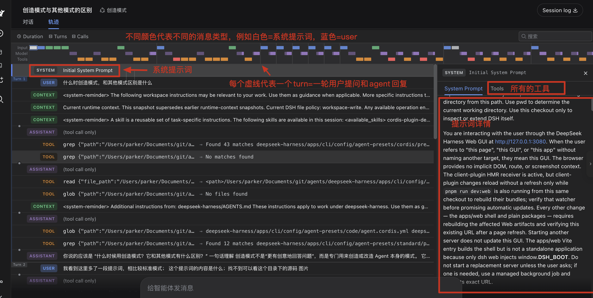

### 3.2.1 一张轨迹图记录了什么

页面顶部是整段 Session 的时间轴，不同颜色的短块代表用户输入、模型生成和工具执行等活动。纵向分隔线划分 Turn：一个 Turn 通常从一次用户提问开始，到 Agent 完成、失败或被取消为止；如果 Agent 需要先调用工具再继续回答，一个 Turn 内会发生多次模型调用。

下面的明细区域将记录分成几类：

- `USER` 是用户真正输入的内容。
- `CONTEXT` 是系统补充给 Agent 的背景资料，例如项目中的 `AGENTS.md`、当前运行环境、权限状态和 Skill 列表。这些内容同样会进入模型请求，但不是用户亲自输入的。
- `SYSTEM` 是某次模型请求实际使用的系统提示词和工具列表。点击 `Initial System Prompt`，右侧的 `System Prompt` 和 `Tools` 页签可以查看完整内容；后续内容发生变化时，轨迹也会显示对应的更新记录。
- `ASSISTANT` 是模型生成的思考内容、过程消息或最终回答。
- `TOOL` 是工具调用及其返回结果，例如搜索文件、读取源码、执行命令和修改文件。

因此，轨迹展示的不是一段整理后的聊天记录，而是 Agent 从接收问题、补充上下文、调用模型和工具，直到结束这一轮工作的完整过程。

### 3.2.2 轨迹日志存在哪里

默认情况下，DeepSeek Harness 把 Session 日志放在 `$DSH_HOME/sessions`；未设置 `DSH_HOME` 时，实际目录是 `~/.dsh/sessions`：

```text
~/.dsh/sessions/
  --项目目录--/
    session-id/
      session.jsonl.zstd
```

项目目录会转换成适合文件系统使用的名称，每个 Session 拥有一个独立目录。当前机器上的一个真实例子是：

```text
/Users/changchun/.dsh/sessions/
  --Users-changchun-Documents-git-github-deepseek-harness--/
    session-faec6646-5c32-4685-97dd-79d37cc7a49b/
      session.jsonl.zstd
```

`.zstd` 表示日志使用 Zstandard 压缩，不能直接作为普通文本文件预览。轨迹右上角的 `Session log` 会下载一个 ZIP：根 Session 的日志是 `session.jsonl`，子 Agent 的日志位于 `subagents/<Session ID>/session.jsonl`，日志引用的图片位于 `media/` 目录。

### 3.2.3 如何查看压缩日志

最直接的方法是点击轨迹右上角的 `Session log`。Harness 会先保存尚未落盘的实时记录，再由服务端解压并生成 ZIP，因此下载内容适合转交给其他人排查问题。

本机也可以使用 `zstd` 命令直接读取，不需要先生成新文件：

```sh
zstd -dc "/absolute/path/to/session.jsonl.zstd" | less
```

也可以解压到临时目录，再用编辑器打开：

```sh
zstd -dc "/absolute/path/to/session.jsonl.zstd" > /tmp/session.jsonl
```

### 3.2.4 为什么 Harness 能渲染这样的轨迹

下面这张图可以概括轨迹的数据来源。用户输入、项目说明、系统提示词、模型输出和工具执行都会先进入同一份 Session 工作记录；运行时，新增记录实时送到 Web 页面，持久化插件同时把它们保存到 `session.jsonl.zstd`。重新打开 Session 时，服务端从文件恢复工作记录，再交给同一个轨迹页面渲染。

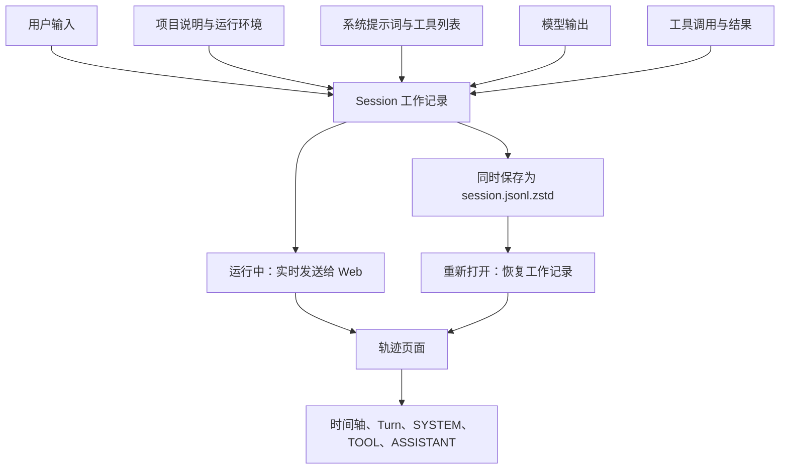

关键点是“一次记录，两种读取方式”：正在运行时读取实时记录，查看历史时读取磁盘记录。两条路径最后都进入同一个轨迹页面，因此实时看到的 SYSTEM、TOOL、ASSISTANT 和 Turn 分组可以在重新打开 Session 后恢复，不需要根据聊天文字猜测 Agent 的工作过程。


## 3.3 多模式：Agent Preset 如何组装不同能力

### 3.3.1 Preset 是什么

DeepSeek Harness 官方源码仓库在 [`dsh-agent-presets` 包的 README](https://github.com/deepseek-ai/deepseek-harness/blob/master/packages/preset/agent-presets/README.md#L1-L7) 中给出了定义：

> A **preset** is a directory holding one `agent.cordis.yml`; the roster mounts it ONCE per process under a standing scope, and each session that names it joins by having its agent scope key parented to the mount's.

中文意思是：

> 一个 preset 是一个包含 `agent.cordis.yml` 的目录。DSH 在进程中挂载这份组合；选择该 preset 的 Session 会让自己的 Agent 加入这份组合，从而获得其中注册的能力。

这里引用的 README 是官方源码仓库中 `dsh-agent-presets` 包的说明文档。TypeScript 实现位于 [`packages/preset/agent-presets/src`](https://github.com/deepseek-ai/deepseek-harness/tree/master/packages/preset/agent-presets/src)。通俗地说，preset 是一套 Agent 能力组合，它通过 `agent.cordis.yml` 组合多个 Cordis Plugin，定义 Persona、提示词、工具、Skills、计划模式和子 Agent 等能力。

### 3.3.2 一个 Preset 目录里有什么

```text
my-preset/
├── agent.cordis.yml    必需：定义 Agent 的 Plugin 组合
├── preset.yml          可选：界面显示名称和说明
├── local.mjs           可选：Preset 自带的本地 Plugin
├── skills/             可选：Preset 自带的 Skills
└── assets/             可选：Plugin 使用的资源
```

`preset.yml` 负责界面展示。例如官方标准模式的 [`preset.yml`](https://github.com/deepseek-ai/deepseek-harness/blob/master/apps/cli/config/agent-presets/standard/preset.yml)：

```yaml
name: 标准模式
description: 功能完整的编码 Agent，支持文件编辑、Shell、文件与网页检索、Skills、计划、目标、子代理和工作流。
order: 1
```

Agent 的能力由同目录下的 [`agent.cordis.yml`](https://github.com/deepseek-ai/deepseek-harness/blob/master/apps/cli/config/agent-presets/standard/agent.cordis.yml) 定义。

### 3.3.3 `agent.cordis.yml` 如何定义 Agent 能力

`agent.cordis.yml` 是一份 Cordis composition，由多条 entry 组成：

```yaml
- id: tool-bash
  name: '@deepseek-ai/dsh-tool-bash'

- id: tool-web
  name: '@deepseek-ai/dsh-tool-web'
  config:
    fetch: false
```

| 字段 | 作用 |
|---|---|
| `id` | 这条实例在当前 composition 中的标识 |
| `name` | 要加载的 Plugin、Cordis 内置入口或本地模块 |
| `config` | 传给 Plugin 的配置 |
| `disabled` | 控制这条实例是否启用 |
| `group` | 标记包含多条子 entry 的分组 |
| `isolate` | 为分组中的 Service 建立独立运行空间 |

`id` 标识实例，`name` 决定加载的内容。`name` 可以指向 DSH Plugin、本地 `./local.mjs`，也可以使用 `cordis:group` 组合多条子 Plugin。整体加载过程是：

```text
读取 agent.cordis.yml
→ 加载 Plugin 实例
→ Plugin 注册工具、提示词和其他能力
→ 选择该 preset 的 Agent 获得这些能力
```

### 3.3.4 Agent Preset 与 Host Composition 如何分工

| Agent Preset | Host Composition |
|---|---|
| Persona 和提示词 | 工具与提示词注册表 |
| 模型可见工具 | Agent Factory 和 Agent Loop |
| Skills、Plan Mode | Model Route、Session 持久化 |
| Subagent 调用工具 | Subagent Registry 和 Provider |
| Agent 级行为 Plugin | Sandbox、Permission 和 Approval |

Host Composition 提供进程共享的基础设施，Agent Preset 决定一类 Agent 使用哪些能力。

Agent Loop 本身也是 Cordis Plugin。官方 Base Bundle [默认加载](https://github.com/deepseek-ai/deepseek-harness/blob/master/packages/bundle/base/cordis.patch.yml#L434-L439)：

```yaml
- id: agent-loop
  name: '@deepseek-ai/dsh-agent-loop'
  config:
    agents: []
```

普通行为扩展可以使用 `agent/*`、`tools/*` 和 `session/*` 事件实现。需要更换核心循环时，可以开发新的 Agent Loop Plugin，并在 Web Profile 的 `~/.dsh/profiles/web/cordis.patch.yml` 中使用相同 ID 覆盖默认行：

```yaml
- id: agent-loop
  name: my-custom-agent-loop
  config:
    agents: []
```

完全重启 DSH 后，Web Profile 会加载自定义 Loop。该 Plugin 需要安装到 Web Profile 能解析的位置，并通过 `ctx.agents.setFactory(...)` 注册 Agent Factory；整个过程无需修改 DSH 官方源码。

### 3.3.5 官方四种内置模式有什么区别

官方四种模式位于 [`apps/cli/config/agent-presets`](https://github.com/deepseek-ai/deepseek-harness/tree/master/apps/cli/config/agent-presets)。点击截图可以打开对应的官方源码目录。

| 项目 | Standard | Code / PTC | Minimal | Cordis / Creator |
|---|---|---|---|---|
| 官方目录 | [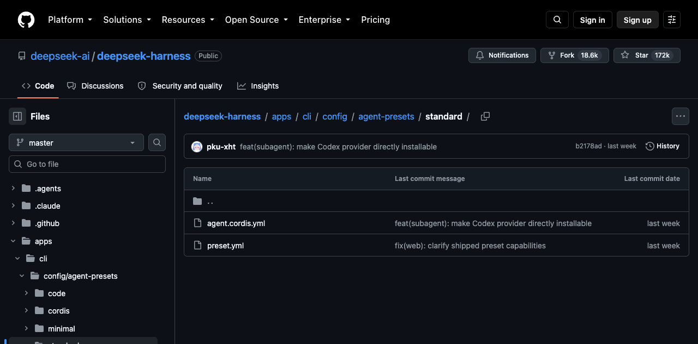](https://github.com/deepseek-ai/deepseek-harness/tree/master/apps/cli/config/agent-presets/standard) | [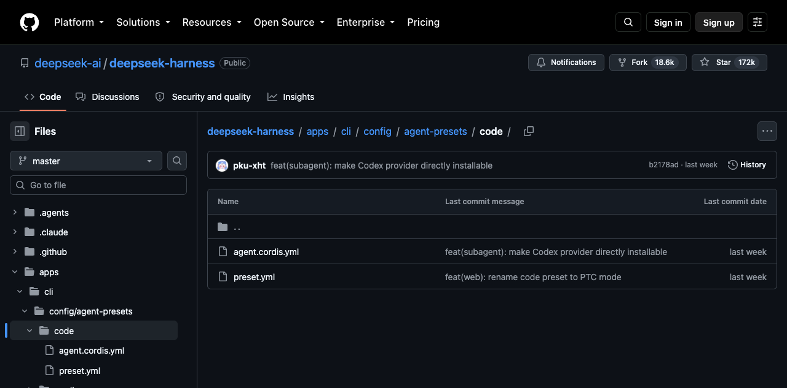](https://github.com/deepseek-ai/deepseek-harness/tree/master/apps/cli/config/agent-presets/code) | [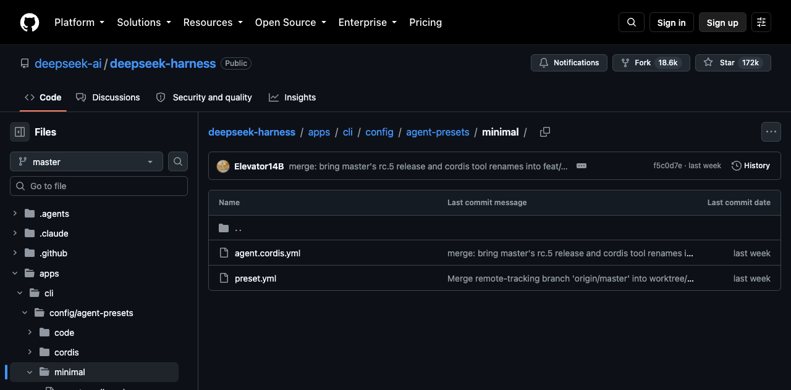](https://github.com/deepseek-ai/deepseek-harness/tree/master/apps/cli/config/agent-presets/minimal) | [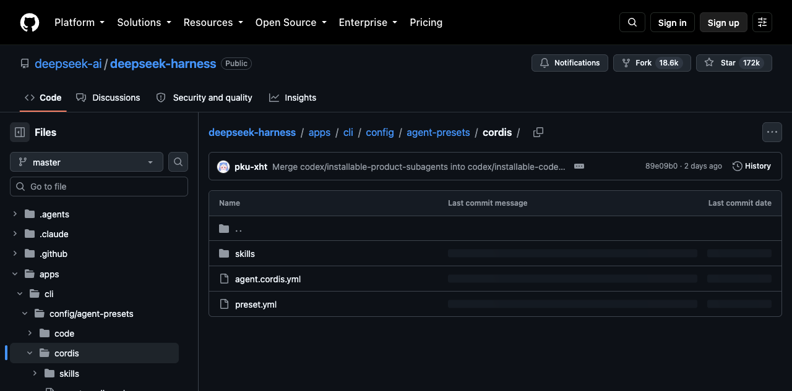](https://github.com/deepseek-ai/deepseek-harness/tree/master/apps/cli/config/agent-presets/cordis) |
| 中文名称 | 标准模式 | PTC 模式 | 极简模式 | 创造模式 |
| 配置基础 | 完整编码 Agent | Standard + Code Mode | 独立双工具组合 | Standard + Cordis 创作能力 |
| Persona | 通用编码 Agent | 与 Standard 相同 | 固定完整 Prompt | Harness/Cordis 专用 Persona |
| 项目指令 | 加载，最多 65536 字节 | 与 Standard 相同 | 不加载 | 与 Standard 相同 |
| 工具呈现 | Native，多工具 | Code，主要呈现 `run_code` | Native，两个工具 | Native，多工具 |
| Skills | 用户和项目 Skills | 与 Standard 相同 | 无 Skill 工具 | Standard Skills + 2 个专用 Skill |
| Plan Mode | 有 | 有 | 无 | 有 |
| Subagent | 有 | 有 | 无 | 有 |
| 主要用途 | 日常开发 | 程序化组合工具 | 最小工具环境 | 创建 Plugin 和 Preset |

#### Standard：标准模式

[`standard/agent.cordis.yml`](https://github.com/deepseek-ai/deepseek-harness/blob/master/apps/cli/config/agent-presets/standard/agent.cordis.yml) 使用以下 Persona：

```text
You are a coding agent powered by the {{model}} model.
Your working directory is {{cwd}}.
```

它还加载项目指令和 Plan Mode 提示词。最终 System Prompt 会结合工作区、可用 Skills、会话状态和 Host 提供的提示词动态组装。主要工具包括：

```text
bash / pwsh
read、read_image、write、edit、glob、grep
job_list、job_output、job_kill、skill
get_goal、create_goal、update_goal、exit_plan_mode
subagent、subagent_fork、list_agents、send_message、interrupt_agent
ask_user_question、todo_write、web_search、workflow、ralph
```

`bash` 和 `pwsh` 根据操作系统二选一；Codex 和 Claude Code 的 Subagent 配置默认禁用。

#### Code / PTC：程序化工具调用模式

[`code/agent.cordis.yml`](https://github.com/deepseek-ai/deepseek-harness/blob/master/apps/cli/config/agent-presets/code/agent.cordis.yml) 保留 Standard 的 Persona、项目指令、Skills 和底层工具，额外加入：

```yaml
- id: tool-presentation
  name: '@deepseek-ai/dsh-agent-tool-presentation'
  config:
    mode: code
```

模型主要看到 `run_code`，在其中编写 TypeScript，并通过自动生成的 SDK 调用底层工具，把多次工具往返组合成一次程序执行。该模式要求 Host 提供 `codeRuntime`。

#### Minimal：极简模式

[`minimal/agent.cordis.yml`](https://github.com/deepseek-ai/deepseek-harness/blob/master/apps/cli/config/agent-presets/minimal/agent.cordis.yml) 使用完整且固定的 System Prompt：

```text
You are a helpful software engineer assistant.
```

它只提供持久 `bash` 与 [`str_replace_editor`](https://github.com/deepseek-ai/deepseek-harness/blob/master/packages/fs/tool-str-replace-editor/src/index.ts#L419-L457)。后者提供四项文件操作：

| 命令 | 作用 |
|---|---|
| `view` | 查看文件、目录或指定行范围 |
| `create` | 创建文件并写入内容 |
| `str_replace` | 将指定旧文本替换为新文本 |
| `insert` | 在指定行后插入文本 |

`str_replace_editor` 负责查看和修改文件，持久 `bash` 负责运行命令与测试，两者组成最小编码环境。

#### Cordis / Creator：创造模式

[`cordis/agent.cordis.yml`](https://github.com/deepseek-ai/deepseek-harness/blob/master/apps/cli/config/agent-presets/cordis/agent.cordis.yml) 保留 Standard 的开发能力，并使用 Harness/Cordis 专用 Persona，说明 Host Composition、Agent Preset、用户 preset 目录和内置 preset 的修改规则。

该模式额外携带两个 Skill：

| Skill | 作用 |
|---|---|
| [`cordis-plugin-development`](https://github.com/deepseek-ai/deepseek-harness/blob/master/apps/cli/config/agent-presets/cordis/skills/cordis-plugin-development/SKILL.md) | 开发、运行和调试动态 Cordis Plugin |
| [`editing-cordis-compositions`](https://github.com/deepseek-ai/deepseek-harness/blob/master/apps/cli/config/agent-presets/cordis/skills/editing-cordis-compositions/SKILL.md) | 创建和修改 Agent Preset，编辑并验证 Cordis composition |

### 3.3.6 安装一个社区 Preset

用户 preset 默认放在 `~/.dsh/.agent-presets/`。以社区项目 [`dsh-plans`](https://github.com/Optim-Agent/dsh-plans) 为例：

```bash
mkdir -p ~/.dsh/.agent-presets
git clone https://github.com/Optim-Agent/dsh-plans.git ~/.dsh/.agent-presets/dsh-plans
```

安装后的目录根部应包含 `agent.cordis.yml`。安装完成后，新建对话并选择 `dsh-plans`。

部分社区仓库包含多个 preset。例如 [`dsh-anchored-standard`](https://github.com/xiaobright/dsh-anchored-standard) 中的 `preset/`、`eternal-minimal/` 和 `combo-anchored/` 分别是独立模式，需要把选中的子目录单独复制到 `~/.dsh/.agent-presets/`。

# 四、社区里面当前的现状

4.1 插件市场

4.2 好玩的preset模式


【star 3.7k】https://github.com/xiaobright/dsh-anchored-standard


下面是前面 5 个社区项目的对比。Star 数是前面查询时的 GitHub 快照，可能会持续变化。

| 项目 | Stars | 主要作用 | 适合场景 |
|---|---:|---|---|
| [dsh-anchored-standard](https://github.com/xiaobright/dsh-anchored-standard) | **3,662** | 首轮采用接近 Minimal 的工具和上下文条件，先“锚定”模型的初始推理轨迹，再逐步开放 Standard 工具能力。仓库还包含 `zero-anchored-standard`、`whoami-standard`、`eternal-minimal`、`wire-think-standard`、`combo-anchored` 等实验变体。 | 日常编码、研究 Minimal/Standard 对模型行为的影响、尝试改善模型首轮工具调用和推理状态。 |
| [dsh-gitbash-preset](https://github.com/liceses/dsh-gitbash-preset) | **135** | 为 DSH 增加 Git Bash 支持，主要解决 Windows 环境下官方 Minimal 模式的 Bash 工具不可用或体验不佳的问题。 | Windows 用户、习惯 Unix 命令、需要使用 Git for Windows/MSYS Bash 的开发环境。 |
| [dsh-plans](https://github.com/Optim-Agent/dsh-plans) | **35** | 将开发任务固化为“只读调查 → Markdown 计划 → Reviewer/Criticizer 审查 → 用户确认 → Goal 执行 → 验收清单”的流程。 | 大型修改、重构、复杂需求、希望先审计划再改代码、需要保留决策和执行记录的项目。 |
| [deepseek-harness-software-OPC](https://github.com/chenshijun900730-bit/deepseek-harness-software-OPC) | **29** | 将软件开发模拟成一个多部门软件公司，由需求、架构、编码、集成、QA、安全和发布等角色协作，并提供可视化的公司管理面板。 | 从想法推进到产品交付、多 Agent 协作、项目流程演示、希望观察任务状态和 Token 使用的场景。 |
| [dsh-router-flash](https://github.com/xiaoxianyu-office/dsh-router-flash) | **13** | 面向 DeepSeek V4 Flash 的路由型 preset/bundle，尝试通过特定路由和工具组合获得更激进或更高效的模型工作模式。 | 使用 V4 Flash、想尝试模型专用 preset、对推理轨迹和性能调优感兴趣的用户。 |
